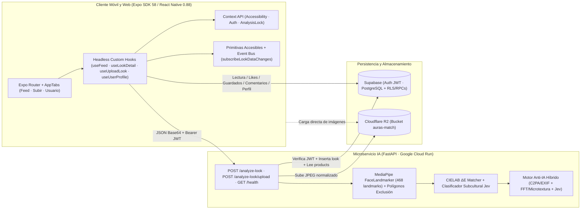

# AurasMatch — Plataforma de Descubrimiento Estético y Recomendación de Cosméticos con Accesibilidad Universal

**Autores:** Kenny Kaven Fang Cen (`kennyface@unisabana.edu.co`) · Diego Eduardo Escalante García (`diegoescga@unisabana.edu.co`)  
**Institución:** Universidad de La Sabana — Facultad de Ingeniería Informática (Desarrollo de Aplicaciones Móviles)  
**Eslogan:** *La primera red de descubrimiento estético y recomendación de cosméticos impulsada por visión por computadora, libre de contenido sintético generado por IA y saturación publicitaria.*

---

## 1. Visión General

**AurasMatch** cierra la brecha entre la inspiración digital de maquillaje y su aplicación física real mediante tres pilares técnicos:

1. **Garantía de Realismo Absoluto (Filtro Anti-IA Híbrido de 3 Etapas):** valida metadatos C2PA/EXIF, forense espectral FFT y microtextura facial anatómica sobre landmarks de MediaPipe junto con detección visual-semántica (`jev-latest`), filtrando contenido sintético (`is_human_verified = true`) e integrando mecanismo de apelación humana (`appeal_status`).
2. **Clasificación Subcultural Precisa:** categoriza looks dentro de las 5 subculturas del MVP (**Jirai Kei**, **Clean Girl**, **Goth**, **E-Girl**, **Y2K**) con etiquetas y puntajes de confianza.
3. **Descomposición Facial y Recomendación de SKUs (`CIELAB ΔE`):** segmenta 4 regiones faciales (`lips`, `brows`, `eyelids`, `lash_line`) con MediaPipe FaceLandmarker (468 puntos faciales), extrae su color dominante en espacio perceptual CIE $L^*a^*b^*$ y recomienda cosméticos reales desde `public.products` (3,085 tonos indexados en 6 categorías).

Todo el cliente móvil/web está construido bajo **WCAG 2.1 / 2.2 Nivel AA y AAA** siguiendo la **Regla Multiplataforma Móvil-Primero** (iOS, Android y Web).

---

## 2. Arquitectura End-to-End



### Estructura del Repositorio

```text
AurasMatch/
├── frontend/                       # App Expo (React Native 0.88.1, Expo Router 58, TypeScript 6)
│   ├── .env.example                # Plantilla de variables públicas EXPO_PUBLIC_*
│   ├── package.json
│   └── src/
│       ├── app/                    # Rutas: index.tsx (Feed), upload.tsx, profile.tsx, look/[id].tsx, _layout.tsx
│       ├── components/             # UI modular DRY: AccessibleModal, ActionBannerButton, LookMiniCard, LookCard, AssistiveVoiceBar
│       ├── constants/theme.ts      # Tokens WCAG AA/AAA (Claro, Oscuro, Alto Contraste) y fuentes dislexia
│       ├── contexts/               # AccessibilityContext, AuthContext, AnalysisLockContext
│       ├── hooks/                  # Headless Hooks (useFeed, useLookDetail, useUploadLook, useUserProfile) + look-action-helpers.ts
│       ├── services/               # supabase.ts (cliente, applyLookMutationToRow, RLS/RPCs, event bus) y r2-storage.ts
│       ├── types/database.ts       # Esquema tipado, diccionarios de dominio y regla Anti-IA (isLookHumanApproved < 0.50)
│       └── utils/                  # a11y-feedback.ts (TTS/háptica), color-names.ts (CIELAB), fuzzy-search.ts (Levenshtein)
├── backend/                        # Microservicio FastAPI + MediaPipe + Jev (Google Cloud Run)
│   ├── app/
│   │   ├── main.py                 # Endpoints /health, /analyze-look, /analyze-look/upload
│   │   ├── core/                   # config.py, supabase_client.py (verificación JWT, R2, PostgreSQL)
│   │   └── cv/                     # mediapipe_cv.py, color_math.py, anti_ai.py, vision_api.py, models/face_landmarker.task
│   ├── Dockerfile
│   ├── pyproject.toml              # Python >= 3.11, FastAPI, MediaPipe, OpenCV, Supabase, Boto3
│   └── README.md
├── docs/                           # Documentación SDD, IEEE, SQL y Entrega Final
│   ├── Entrega_Final_AurasMatch.md # Documento técnico final (formato IEEE Markdown)
│   ├── Entrega_Final_AurasMatch.tex# Fuente LaTeX oficial IEEEtran para compilar el PDF de entrega
│   ├── Presentacion_y_Demo_Fase3.md# Guion de presentación ejecutiva y demo en vivo (10% + mapa 40%)
│   ├── JUSTIFICACIONES_TECNICAS.md # Decisiones arquitectónicas, DRY, Anti-IA y accesibilidad
│   ├── supabase-rls-and-rpcs.sql   # Políticas RLS, triggers y RPCs atómicas para Supabase
│   ├── CONCEPTOS_Y_DEFINICIONES.md # Glosario técnico progresivo
│   ├── specs/                      # Especificaciones Fase 00 a Fase 09
│   └── phases/                     # Guías técnicas y de pruebas (README-fase-01.md .. README-fase-08.md)
├── projectProposalDocs/            # Propuestas originales (Fase 1, Fase 2) y Rúbrica Fase 3
├── scripts/data_ingestion/         # Scripts auxiliares de ingesta de catálogo y looks
└── README.md
```

---

## 3. Variables de Entorno y Configuración de Base de Datos

### 3.1. Script SQL en Supabase (Requerido una sola vez)
Para habilitar escritura segura con clave pública `anon` bajo **Row-Level Security (RLS)** en publicación/edición de Alt-Text, apelaciones, likes y comentarios sin tocar las políticas ya activas (`products`, `profiles`, `saved_looks`) ni el schema `auth`:

1. Abre **Supabase Dashboard → SQL Editor → New query**.
2. Pega y ejecuta [`docs/supabase-rls-and-rpcs.sql`](docs/supabase-rls-and-rpcs.sql).
   - Otorga permisos (`GRANT`) y crea la política RLS `"looks_update_own"` (`FOR UPDATE TO authenticated`) sobre `public.looks`.
   - Crea el trigger `protect_look_verification_columns` (`trg_protect_look_verification`) para impedir alteración de `user_id`, `is_human_verified` o `ai_confidence_score` desde clientes.
   - Expone las funciones RPC `SECURITY DEFINER` `toggle_look_like(uuid)` y `add_look_comment(uuid, jsonb)` y recarga el schema de PostgREST.

### 3.2. Variables de Entorno del Frontend (`frontend/.env`)
Copia [`frontend/.env.example`](frontend/.env.example) a `frontend/.env` y completa los valores reales (el archivo `.env` está ignorado por Git y **nunca debe contener `sb_secret_...`**):

```env
EXPO_PUBLIC_SUPABASE_URL="https://wcxegqikzpaiavtrvmsy.supabase.co"
EXPO_PUBLIC_SUPABASE_ANON_KEY="<tu_llave_publica_anon_o_publishable>"
EXPO_PUBLIC_R2_PUBLIC_URL="<url_publica_de_tu_bucket_r2>"
EXPO_PUBLIC_BACKEND_URL="<url_publica_cloud_run_o_http://localhost:8000>"
```

*(Si necesitas presignado R2 en modo simulación local desde el cliente, el servicio [`r2-storage.ts`](frontend/src/services/r2-storage.ts) también lee opcionalmente `EXPO_PUBLIC_R2_ACCOUNT_ID`, `EXPO_PUBLIC_R2_ACCESS_KEY`, `EXPO_PUBLIC_R2_SECRET_KEY` y `EXPO_PUBLIC_R2_BUCKET` desde entorno).*

---

## 4. Instalación y Ejecución

### 4.1. Frontend (Expo / React Native — Móvil y Web)
Requisitos: Node.js LTS, npm y **Expo Go** (en Android/iOS) o navegador web.

```bash
cd frontend
npm install
npx tsc --noEmit          # Verificación de tipos TypeScript
npx expo start            # Abre QR para Expo Go; presiona 'a' (Android), 'i' (iOS) o 'w' (Web)
```

Scripts disponibles en [`frontend/package.json`](frontend/package.json):
- `npm start` (`expo start`)
- `npm run android` (`expo start --android`)
- `npm run ios` (`expo start --ios`)
- `npm run web` (`expo start --web`)

### 4.2. Backend IA Local o Docker (Opcional si no usas la instancia Cloud Run)
Requisitos: Python `>= 3.11` y `uv` (o Docker).

```bash
cd backend
uv sync
uv run uvicorn app.main:app --reload --port 8000
```

O mediante contenedor Docker:
```bash
cd backend
docker build -t aurasmatch-backend .
docker run -p 8000:8000 --env-file app/core/.env aurasmatch-backend
```

---

## 5. Resumen de Funcionalidades y Accesibilidad Móvil (WCAG 2.1 / 2.2)

- **Navegación predecible y *Gradual Engagement*:** 3 pestañas (`Feed`, `Subir`, `Usuario`) con bloqueo de navegación durante análisis IA (`AnalysisLockContext`) y exploración pública sin registro obligatorio.
- **Feed Comunitario con Filtro Triple y Tolerancia a Errores:** solo publicaciones verificadas como humanas (`is_human_verified = true` y `ai_confidence_score < 0.50` vía `isLookHumanApproved`), búsqueda con distancia de **Levenshtein** + chips predictivos y panel flotante de Filtro Triple (Subcultura × Área Facial × Familia Cromática CIELAB).
- **Detalle estilo Pinterest y Popups Accesibles:** zoom por botones (`100%` a `350%` en pasos de `50%`), síntesis de voz TTS en español (`expo-speech` / `window.speechSynthesis`), modal Anti-IA de 4 etapas, modal de producto unificado en `AccessibleModal` con `accessibilityViewIsModal={true}` y cierre `Escape` en Web, comentarios plegables sin límite de tiempo y mini-feed de looks similares (`LookMiniCard`).
- **Subida con MediaPipe / Jev, Alt-Text Editable y Apelación:** captura por cámara/galería (`applyPickedImageAsset`) con guía de iluminación modal, borrador persistente sin expiración en `AsyncStorage`, envío JSON Base64 a `POST /analyze-look`, Alt-Text editable generado por IA, bloqueo estricto de publicación al Feed cuando `ai_confidence_score >= 0.50`, fallback de simulación asistida y apelación humana (`appeal_status = 'pending'`).
- **Accesibilidad Universal en Perfil (`AccessibilityModal` + `AssistiveVoiceBar`):** temas Claro/Oscuro/Alto Contraste AAA (`21:1`), tipografía para dislexia (`Verdana`/`Arial`/`Courier` + mayor interlineado), escalado hasta `200%` con cambio automático a 1 columna en Feed desde `150%`, reducción de movimiento y barra flotante de comandos asistidos para diversidad motriz (WCAG 2.5.3).

---

## 6. Documentación Técnica y Entregables de Fase 3

- **Repositorio Oficial / Demo Web (si aplica):** `[inserte aqui URL oficial del repositorio y demo pública]`
- **Documento Técnico Final (Formato IEEE Markdown):** [`docs/Entrega_Final_AurasMatch.md`](docs/Entrega_Final_AurasMatch.md)
- **Fuente LaTeX Oficial (`IEEEtran`) para exportar PDF:** [`docs/Entrega_Final_AurasMatch.tex`](docs/Entrega_Final_AurasMatch.tex) *(compilar a PDF en `[inserte aqui ruta final /docs/Entrega_Final_AurasMatch.pdf]`)*
- **Guion de Presentación y Demo en Vivo (10 % + Defensa 40 %):** [`docs/Presentacion_y_Demo_Fase3.md`](docs/Presentacion_y_Demo_Fase3.md)
- **Justificaciones de Decisiones Técnicas:** [`docs/JUSTIFICACIONES_TECNICAS.md`](docs/JUSTIFICACIONES_TECNICAS.md)
- **Propuestas y Rúbrica Oficial:** [`projectProposalDocs/`](projectProposalDocs/)
- **Glosario de Conceptos:** [`docs/CONCEPTOS_Y_DEFINICIONES.md`](docs/CONCEPTOS_Y_DEFINICIONES.md)
- **Guías y pruebas por fase (01–08):** [`docs/phases/`](docs/phases/)
- **Especificaciones SDD (00–09):** [`docs/specs/`](docs/specs/)

