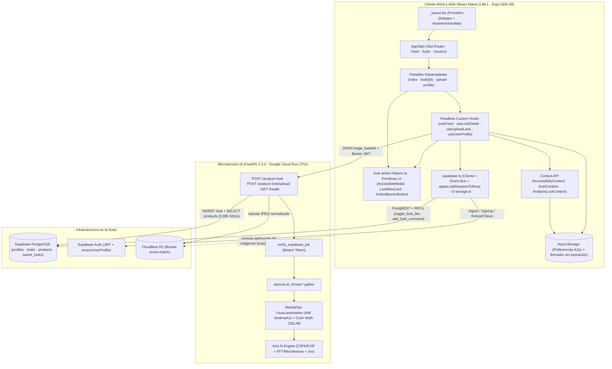
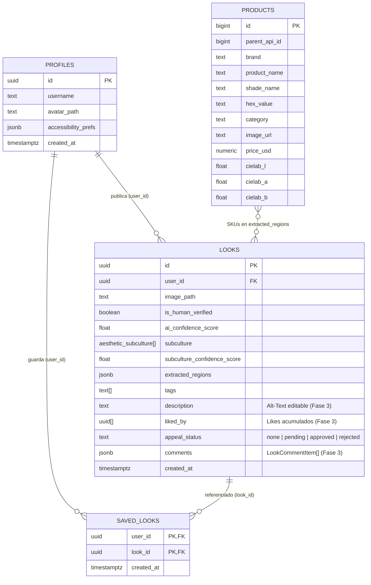

# AurasMatch: Plataforma Móvil de Descubrimiento Estético y Recomendación Personalizada de Cosméticos Basada en Visión por Computadora

**Entrega Final (Fase 3) — Despliegue de Producto, Accesibilidad Móvil y Defensa Técnica**  
**Asignatura:** Desarrollo de Aplicaciones Móviles (`[inserte aqui NRC o grupo de la asignatura]`)  
**Institución:** Universidad de La Sabana — Facultad de Ingeniería (Ingeniería Informática), Cundinamarca, Colombia  
**Docente:** `[inserte aqui nombre completo del profesor]`  
**Fecha de entrega:** `[inserte aqui fecha oficial de entrega]`  
**Repositorio:** `[inserte aqui URL oficial del repositorio GitHub/GitLab]`  

**Autores:**  
Kenny Kaven Fang Cen — ID: `[inserte aqui ID universitario]` (`kennyface@unisabana.edu.co`)  
Diego Eduardo Escalante García — ID: `[inserte aqui ID universitario]` (`diegoescga@unisabana.edu.co`)  

---

> ***Abstract*** — **AurasMatch** es una aplicación móvil multiplataforma (React Native 0.88 / Expo SDK 58 para iOS, Android y Web) dedicada al descubrimiento visual de maquillaje real y a la recomendación personalizada de cosméticos mediante visión por computadora. Frente a la proliferación de contenido sintético generado por inteligencia artificial (*AI slop*), la saturación publicitaria y la dificultad para identificar tonos físicos replicables, el sistema integra en un flujo único: (1) un **motor híbrido Anti-IA de tres etapas** (inspección de procedencia C2PA/EXIF, forense espectral FFT con microtextura facial normalizada por luminancia y evaluación visual-semántica), validado bajo un umbral estricto `< 0.50` en servidor y cliente; (2) clasificación en cinco subculturas estéticas emergentes (*Jirai Kei, Clean Girl, Goth, E-Girl, Y2K*) mediante un modelo de visión-lenguaje (**Jev**); y (3) segmentación facial en cuatro regiones anatómicas con **MediaPipe FaceLandmarker** (468 landmarks) y emparejamiento perceptual en espacio **CIELAB ($\Delta E$ CIE76)** sobre un catálogo real de **3,085 SKUs cosméticos** en Supabase PostgreSQL. Sobre esta base concebida en Fase 1, la arquitectura consolida íntegramente las **16 promesas de accesibilidad universal** propuestas en Fase 2 conforme a las pautas **WCAG 2.1 / 2.2 Nivel AA y AAA**, aplicando una refactorización *DRY* que compactó la capa cliente para garantizar mantenibilidad y estabilidad nativa en Android e iOS.
>
> ***Index Terms*** — visión por computadora, descubrimiento visual, recomendación de cosméticos, accesibilidad móvil, WCAG 2.1/2.2, análisis facial, detección anti-IA, React Native, Expo, CIELAB.

---

## I. Consolidación de Visión del Producto, Problema y Estado del Arte (Evolución Fase 1)

### A. Resumen Ejecutivo, Propuesta de Valor (UVP) y *User Personas*

* **Nombre definitivo del proyecto:** AurasMatch.
* **Eslogan:** *La primera red de descubrimiento estético y recomendación de cosméticos impulsada por visión por computadora, libre de contenido sintético generado por IA y saturación publicitaria.*
* **Propósito:** Cerrar la brecha entre la inspiración digital de maquillaje y su recreación física en el mundo real. La plataforma permite explorar looks verificados como 100 % humanos (`is_human_verified = true` y `ai_confidence_score < 0.50`), filtrarlos simultáneamente por subcultura, zona anatómica y color perceptual, y analizar fotografías propias para recuperar cosméticos comprables equivalentes por región facial.

#### *User Personas* Consolidadas (Fases 1, 2 y 3)

1. **Usuario Primario (Entusiasta Gen Z / Millennial):** Consumidores activos en subculturas visuales (*E-Girl, Goth, Clean Girl, Jirai Kei, Y2K*) y usuarios cotidianos de maquillaje familiarizados con compras en línea. Sufren frustración ante contenido sintético irreplicable (*AI slop*), ausencia de etiquetas para subculturas de nicho y saturación publicitaria. AurasMatch les ofrece un feed humano curado, Filtro Triple contextual y mapeo automático hacia SKUs reales.
2. **Usuario Secundario (Maquillador Independiente / Creador / Marca):** Artistas de maquillaje, creadores de contenido y marcas orientadas a *e-commerce* y analítica de tendencias. Enfrentan pérdida de alcance orgánico frente a granjas de contenido sintético y expectativas irreales de clientes basadas en IA. AurasMatch brinda atribución directa a productos del catálogo, desglose transparente del motor Anti-IA y un **mecanismo formal de apelación humana** (`appeal_status`).
3. **Usuario con Necesidades de Accesibilidad (Consolidación Fase 2):** Personas con **motricidad limitada** (uso de teclado externo, pulsadores o un único toque sin gestos complejos), **diversidad cognitiva** (dislexia, sensibilidad a tiempos límite o epilepsia fotosensible), **diversidad auditiva** y **diversidad visual** (daltonismo, baja visión, fotofobia y uso de lectores *TalkBack*, *VoiceOver* o *NVDA*). La app responde mediante zoom discreto por botones, borradores locales sin expiración, tipografías para dislexia, escalado tipográfico hasta 200 %, tema Alto Contraste AAA (21:1), alertas visuales/hápticas, síntesis de voz TTS y *Alt-Text* generado por IA editable.

---

### B. Síntesis del Problema y Análisis Competitivo Actualizado

El descubrimiento estético actual presenta tres puntos de fricción documentados desde la Propuesta de Fase 1: (1) **inviabilidad práctica**, pues las referencias generadas o alteradas con IA exhiben pigmentos y texturas imposibles de reproducir físicamente [8]; (2) **desalineación comercial y algorítmica**, donde las redes tradicionales saturan con anuncios intrusivos —rechazados por el **71 %** de consumidores según YouGov [3]— e ignoran micro-estéticas emergentes; y (3) **dificultad en la identificación de productos**, obligando a adivinar tonos y acabados sin descomposición automatizada.

En el plano de mercado, la industria de tecnología aplicada a la belleza proyecta alcanzar **USD \$172.9 mil millones para 2030** con una tasa de crecimiento anual compuesta (**CAGR**) de **17.9 %** [1], [2]. Paralelamente, la evidencia empírica refleja un rechazo creciente al contenido artificial: Meltwater documenta un aumento de nueve veces en menciones de *"AI slop"* con **54 %** de sentimiento negativo [4]; Raptive señala una caída del **14 %** en intención de compra ante piezas percibidas como IA [4]; y estudios apoyados en la Teoría de la Elección Racional y evaluaciones de la Universidad de Aalto confirman fatiga digital y menor satisfacción por sobrecarga e irrealismo visual [5]–[7].

La **Tabla I** sintetiza la comparación frente a las soluciones existentes identificadas en la Fase 1 (*SkinSort*, *Dupe AI*, *Temptalia*, *Pinterest* y *MakeupAlley* como referencia comunitaria de reseñas).

**TABLA I. Matriz Comparativa de Competidores (Fase 1) vs. Producto Final AurasMatch**

| Plataforma | Enfoque Principal | Experiencia de Usuario | Modelo / Alcance | Brechas Superadas por AurasMatch |
| :--- | :--- | :--- | :--- | :--- |
| **SkinSort** | Cuidado facial (*skincare*), compatibilidad de ingredientes y rutinas. | Búsqueda por ingrediente y puntaje de compatibilidad; incluye base auxiliar de maquillaje. | Freemium con anuncios, afiliados y plan *Premium*. | No ofrece descubrimiento visual de looks de maquillaje, taxonomía subcultural ni análisis facial por fotografía. |
| **Dupe AI** | Búsqueda de alternativas económicas (*dupes*) desde una foto. | El usuario carga un look y la app sugiere productos equivalentes más baratos. | Freemium con compras integradas (*Dupe Pro*). | Centrada en *dupes* individuales; carece de red social verificada Anti-IA, subculturas y accesibilidad adaptativa. |
| **Temptalia** *(ref. comunidad MakeupAlley)* | Investigación especializada de productos, reseñas y *swatches* textuales. | Orientada a usuarios que ya conocen la marca o tono exacto (*Swatch Gallery*, *Dupe List*). | Gratuito con publicidad, afiliados y contenido patrocinado. | No descompone selfies reales del usuario ni permite descubrir estéticas emergentes sin búsqueda previa de marca. |
| **Pinterest** | Búsqueda visual generalista mediante *Pins* y tableros. | Exploración amplia por texto/imagen entre millones de referencias heterogéneas. | Gratuito con alta carga publicitaria y enlaces comerciales. | Saturado de contenido sintético generado por IA [8], sin clasificación cosmética ni extracción perceptual CIELAB. |
| **AurasMatch (Final)** | **Red estética 100 % humana + CV facial + Accesibilidad Universal.** | Feed verificado sin IA, Filtro Triple, análisis por zona facial propia, popup de SKU y ajuste AAA. | Cero anuncios intrusivos; atribución directa a **3,085 SKUs** en Supabase. | **Unifica por primera vez:** motor Anti-IA de 3 etapas (`< 0.50`), clasificación subcultural, CIELAB $\Delta E$ y cumplimiento WCAG 2.1/2.2. |

---

### C. Innovación Lograda y Evolución Técnica del MVP (Propuesta Fase 1 vs. Producto Fase 3)

Durante la materialización del prototipo sobre infraestructura real en la nube (Google Cloud Run sin GPU, Supabase y Cloudflare R2), el equipo transformó la arquitectura conceptual de la Fase 1 en una solución de baja latencia apta para dispositivos móviles (**Tabla II**).

**TABLA II. Evolución Técnica del Prototipo Entre Propuesta Fase 1 e Implementación Fase 3**

| Dimensión Técnica | Propuesta Inicial (Fase 1) | Implementación Final Verificada (Fase 3) | Justificación Ingenieril |
| :--- | :--- | :--- | :--- |
| **Segmentación Facial** | Redes pesadas *BiSeNet* / *SegFace* sobre piel, ojos y labios. | **MediaPipe `FaceLandmarker`** (468 landmarks 3D) con polígonos de exclusión (`lips`, `brows`, `eyelids`, `lash_line`) [20]. | Evita inferencia pesada de parsing en contenedores CPU sin GPU; excluye dientes (`LIP_INNER_POLYGON`) y esclerótica ocular para no contaminar el tono del maquillaje (`backend/app/cv/mediapipe_cv.py`). |
| **Clasificación Subcultural** | *Fine-tuning* local sobre modelo `CLIP`. | Consulta estructurada asíncrona a **`Jev` (`jev-latest`)** en paralelo con búsqueda de catálogo. | Clasifica *Jirai Kei, Clean Girl, Goth, E-Girl, Y2K* sin alojar gigabytes de pesos CLIP en RAM de Cloud Run y aporta señal semántica Anti-IA (`backend/app/cv/vision_api.py`). |
| **Emparejamiento de Color y Catálogo** | Base vectorial inicial de **1,000 cosméticos** enfocada en labios y ojos. | **3,085 SKUs** reales indexados en `public.products` en **6 categorías**, emparejados vía **CIE $L^*a^*b^*$ ($\Delta E$ CIE76)** y centroide equivalente a `K=1`. | Supera en **+208 %** el alcance cromático planteado en Fase 1; usa media aritmética sobre píxeles válidos (idéntica matemáticamente a `KMeans(n_clusters=1)` sin consumo extra de memoria) y traduce colores a español (`backend/app/cv/color_math.py`, `frontend/src/utils/color-names.ts`). |
| **Filtro Anti-IA** | Validación híbrida C2PA + características visuales. | **Motor híbrido de 3 etapas (`anti_ai.py`):** (1) C2PA/JUMBF/EXIF, (2) Forense espectral FFT + microtextura normalizada por luminancia (`cheek`/`forehead` vs. nitidez periocular), (3) Fusión con `vision_ai_score` y umbral **`< 0.50`**. | Mitiga falsos positivos en piel oscura o iluminación suave mediante piso de luminancia (`0.18`); validado tanto en backend como en cliente (`isLookHumanApproved` en `database.ts`). |

---

## II. Arquitectura de Software Móvil e Implementación Técnica

### A. Diagrama de Arquitectura *End-to-End*

La solución opera bajo una arquitectura desacoplada de tres capas optimizada para ejecución nativa (Android / iOS mediante Expo SDK 58 / React Native `0.88.1`) y Web (`react-native-web`):

*(Nota para versión PDF IEEE: si exporta el documento final vía Overleaf con `Entrega_Final_AurasMatch.tex`, genere e inserte la imagen renderizada de este diagrama en `[inserte aqui figura PNG/PDF exportada del diagrama de arquitectura]` si desea sustituir la vista esquemática textual).*

---

### B. Decisiones Arquitectónicas, Estructura de Componentes y Compactación *DRY*

1. **Navegación Predictiva Basada en `<Slot />` y Bloqueo de Análisis (`app-tabs.tsx`, `analysis-lock-context.tsx`):**  
   El contenedor estándar `<Tabs>` de `expo-router/ui` utilizaba internamente redirección automática sobre pestañas visibles, expulsando la ruta dinámica `/look/[id]`. Se implementó `AppTabs` sobre `<Slot />`, `usePathname()` y `useRouter()` para mantener fija y predecible la barra inferior de 3 pestañas (`Feed`, `Subir`, `Usuario`). Adicionalmente, `AnalysisLockContext` bloquea transiciones entre pestañas y el botón físico *Atrás* en Android (`BackHandler`) mientras se ejecuta una petición en Cloud Run.
2. **Patrón *Headless Custom Hooks* y Justificación de React Context API frente a Redux Toolkit:**  
   Siguiendo separación estricta entre presentación y lógica, las pantallas JSX delegan toda asincronía en seis hooks principales (`useFeed`, `useLookDetail`, `useUploadLook`, `useUserProfile`, `useAuth`, `useAccessibility`). El estado verdaderamente global abarca tres dominios ortogonales gestionados con **Context API** en `_layout.tsx`: preferencias de accesibilidad persistentes (`AccessibilityContext`), sesión JWT (`AuthContext`) y bloqueo de análisis (`AnalysisLockContext`). Frente a **Redux Toolkit**, Context API evitó sobrecarga innecesaria de *slices*, *reducers* y normalización de tablas remotas ya administradas por Supabase; sin embargo, al estar aislado tras hooks, el proyecto puede adoptar Redux Toolkit o TanStack Query a futuro sin modificar las pantallas.
3. **Sincronización Reactiva *Cross-Screen* y Persistencia Segura (`supabase.ts`, `AsyncStorage`):**  
   Como `<Slot />` desmonta pantallas inactivas al conmutar pestañas, [`supabase.ts`](../frontend/src/services/supabase.ts) incorpora un bus de eventos en memoria (`subscribeLookDataChanges`) que propaga mutaciones reales (`like`, `save`, `comment`, `description`, `appeal`, `created`) y las aplica de forma uniforme mediante la función pura `applyLookMutationToRow`. El cliente de Supabase utiliza `safeAuthStorage` (adaptador seguro ante SSR Web donde `window` no está definido) con `persistSession: true` y `autoRefreshToken: true`, mientras que `useUploadLook` mantiene borradores locales indefinidos en `@aurasmatch/upload_look_draft_v1`.
4. **Compactación Modular bajo Principio *DRY* (*Don't Repeat Yourself*):**  
   Previo al cierre de la Fase 3 se ejecutó una auditoría de compactación sobre `frontend/src/` (rama `refactor/frontend-dry-compaction`, eliminando código muerto/duplicado con un balance neto de `-2,445` / `+1,242` líneas):
   * **Modales unificados ([`accessible-modal.tsx`](../frontend/src/components/ui/accessible-modal.tsx)):** consolidación de los 6 diálogos de la app (*Login/Registro, Detalle de Producto, Guía de Iluminación, Transparencia Anti-IA, Ajustes de Accesibilidad*) sobre `AccessibleModal` y `ContextualAuthModal`.
   * **Primitivas de tarjeta y banners compartidos:** [`action-banner-button.tsx`](../frontend/src/components/ui/action-banner-button.tsx) unifica los disparadores de Perfil y Subida; [`look-mini-card.tsx`](../frontend/src/components/look/look-mini-card.tsx) unifica las tarjetas en grilla de 2 columnas entre Perfil y Looks Similares.
   * **Lógica y diccionarios centralizados:** [`look-action-helpers.ts`](../frontend/src/hooks/look-action-helpers.ts) unifica las actualizaciones optimistas, reintento/reversión, vibración háptica y anuncios TTS de *Me gusta* y *Guardados*; `applyPickedImageAsset` unifica galería y cámara en `use-upload-look.ts`; y [`database.ts`](../frontend/src/types/database.ts) centraliza diccionarios de regiones faciales, iconos y categorías cosméticas.
5. **Transporte Móvil Resiliente y Optimización de Rendimiento:**  
   Para evitar la excepción nativa `unsupported formdatapart implementation` de React Native `0.88` al enviar archivos `FormData` multiparte, el cliente transmite `image_base64` vía JSON a `POST /analyze-look` (`upload_to_r2: true`). En listas, `index.tsx` adapta dinámicamente `FlatList` (`numColumns` `2` vs `1` columna desde escala $\ge 150\%$), `use-user-profile.ts` ejecuta consultas en paralelo con `Promise.all`, y `backend/app/main.py` descarga el cálculo de MediaPipe a un hilo separado (`asyncio.to_thread`) paralelizando la clasificación con `Jev` y la consulta de SKUs en Supabase (`asyncio.gather`).

---

### C. Modelo de Datos y Contratos de Servicio

La base de datos PostgreSQL en Supabase consta de **cuatro tablas relacionales** (`profiles`, `looks`, `products`, `saved_looks`), extendiendo `public.looks` aditivamente para conservar compatibilidad intacta con Cloud Run:

#### Seguridad *Row-Level Security* (RLS), RPCs Atómicas y Contratos REST

* **Migración RLS/RPC ([`docs/supabase-rls-and-rpcs.sql`](supabase-rls-and-rpcs.sql)):** habilita la política `"looks_update_own"` (`FOR UPDATE TO authenticated`) sobre `public.looks` para guardar `description` y apelaciones del propietario, instala el trigger `protect_look_verification_columns` para impedir que clientes alteren `user_id`, `is_human_verified` o `ai_confidence_score`, y expone funciones `SECURITY DEFINER` (`toggle_look_like(uuid)` y `add_look_comment(uuid, jsonb)`) para interacciones seguras sobre looks de terceros sin abrir escritura directa en `looks`. El cliente usa `ensureUserProfile()` idempotente al autenticar sin exponer `service_role`.
* **Microservicio Cloud Run (`backend/app/main.py` v2.3.0):**
  * `GET /health`: verificación de estado del servicio.
  * `POST /analyze-look` *(JWT Supabase obligatorio)*: recibe `{ image_url | image_base64, upload_to_r2, r2_folder }`, ejecuta MediaPipe (retorna `422 Unprocessable Entity` si no detecta rostro), calcula tonos CIELAB + 3,085 SKUs, consulta `Jev`, evalúa Anti-IA de 3 etapas (`ai_threshold = 0.50`), carga JPEG a Cloudflare R2 e inserta el look en Supabase.
  * `POST /analyze-look/upload`: alternativa multiparte binaria disponible en el servidor.

---

## III. Implementación y Auditoría de Accesibilidad Móvil (Consolidación Fase 2)

### A. Cumplimiento de Pautas WCAG 2.1 / 2.2 Nivel AA y AAA y Regla Móvil-Primero

El diseño accesible adopta las pautas oficiales **WCAG 2.1 / 2.2** [19] atendiendo tensiones documentadas de accesibilidad digital en usuarios reales [13]:

1. **Semántica Nativa para *TalkBack* / *VoiceOver* y Guardas Multiplataforma:**  
   Cada control interactivo declara `accessible`, `accessibilityRole` estrictamente dentro del enum nativo válido de React Native (`button`, `tab`, `switch`, `search`, `header`, `alert`, `text`, `image`, `toolbar`, `checkbox`), `accessibilityLabel`, `accessibilityHint` y `accessibilityState`. Atributos exclusivos WAI-ARIA de navegador (`role="dialog"`, `role="alert"`, `aria-modal`, `tabIndex`) quedan encapsulados bajo `Platform.OS === 'web'`, eliminando excepciones fatales en `RCTViewManager` en Android/iOS. Asimismo, `LookCard` expone `accessibilityActions` (`activate`, `like`, `save`, `speak`) para lectura y acción unificada sin focos fragmentados.
2. **Contraste Cromático Verificado y Tipografía Adaptativa (`theme.ts`, `themed-text.tsx`):**  
   * **Tema Claro:** texto `#111318` sobre `#FFFFFF` (**18.5:1**), secundario `#4A4E58` (**7.1:1**), primario `#8E1B4E` (**7.8:1**), enlace `#0052CC` (**7.3:1**).
   * **Tema Oscuro:** texto `#F7F8FA` sobre `#0B0C0E` (**19.6:1**), secundario `#B8BDC7` (**9.8:1**), primario `#FF85B3` (**8.9:1**).
   * **Modo Alto Contraste (AAA):** fondo `#000000`, texto `#FFFFFF` (**21:1**), acento `#FFFF00` (**19.6:1**) y primario `#00FFFF` (**16.7:1**).
   * **Escalado al 200 % sin *clipping* e Independencia del Color:** `ThemedText` escala conjuntamente `fontSize` y `lineHeight` (`maxFontSizeMultiplier={2.0}`), suma `+0.12` de interlineado y `0.6` de `letterSpacing` en modo dislexia (`Verdana/Arial` o `Courier`), y conmuta la grilla del Feed a 1 columna desde `font_scale >= 1.5`. `ColorSwatchBadge` oculta el círculo puramente visual al lector (`importantForAccessibility="no"`) y expone nombre del pigmento en español + código `HEX`.
3. **Ergonomía Táctil, *Bypass Blocks* y Paridad Multimodal:**  
   `MinTouchTargetSize = 48` dp (superior a los $44 \times 44\text{ pt}$ exigidos por WCAG 2.5.5) y `DEFAULT_HIT_SLOP = 8` dp se aplican transversalmente vía `AccessiblePressable`, junto con `focusRing` visible de `2 px`, plegables `AccessibleCollapsible` (WCAG 2.4.1), y `VisualAlertBanner` (alerta visual + vibración háptica + `announceStatus`).

---

### B. Matriz Trazable Completa (Propuesta Corte 2 vs. Implementación Final)

La **Tabla III** traza las **16 promesas formuladas en `2ndPhaseProposal.pdf` (Sección V)** contra sus archivos y líneas verificadas en el código fuente actual tras la compactación *DRY*:

**TABLA III. Trazabilidad de la Propuesta de Accesibilidad (Corte 2) al Código Fuente Final (Fase 3)**

| Promesa (Corte 2) | Criterio WCAG | Archivo(s) y Referencias Verificadas | Mecanismo Implementado | Estado |
| :--- | :--- | :--- | :--- | :--- |
| **A.1 Navegación completa por teclado** | 2.1.1, 2.4.7, [9] | [`accessible-pressable.tsx`](../frontend/src/components/ui/accessible-pressable.tsx#L125-L145), [`app-tabs.tsx`](../frontend/src/components/app-tabs.tsx#L76-L102), [`accessible-modal.tsx`](../frontend/src/components/ui/accessible-modal.tsx#L87-L90), [`triple-filter-dropdown.tsx`](../frontend/src/components/feed/triple-filter-dropdown.tsx#L60-L68) | `tabIndex`, anillo de foco `focusRing` al `onFocus`, navegación `Tab`/`Enter` y cierre por tecla `Escape` en Web. | Implementado |
| **A.2 Compatibilidad con tecnologías de asistencia** | 4.1.2, 2.1.1 | [`accessible-pressable.tsx`](../frontend/src/components/ui/accessible-pressable.tsx#L125-L135), [`look-card.tsx`](../frontend/src/components/feed/look-card.tsx#L165-L175) | Propiedades nativas `accessibilityRole`, `accessibilityState`, `accessibilityHint` y `accessibilityActions` en tarjetas del feed. | Implementado |
| **A.3 Comandos de voz e integración con asistentes** | 2.5.3 (*Label in Name*) | [`assistive-voice-bar.tsx`](../frontend/src/components/ui/assistive-voice-bar.tsx#L31-L406), [`_layout.tsx`](../frontend/src/app/_layout.tsx#L21-L34), [`accessibility-modal.tsx`](../frontend/src/components/accessibility/accessibility-modal.tsx#L287-L308), [`look/[id].tsx`](../frontend/src/app/look/%5Bid%5D.tsx#L258-L329) | Nombres accesibles consistentes con etiquetas visibles + paleta flotante `AssistiveVoiceBar` activable con atajos y guía nativa para *Voice Control* / *Voice Access*. | Implementado |
| **A.4 Zonas de interacción amplias** ($\ge 44\times 44$ px) | 2.5.5, 2.5.8, [10] | [`theme.ts`](../frontend/src/constants/theme.ts#L116), [`accessible-pressable.tsx`](../frontend/src/components/ui/accessible-pressable.tsx#L157-L158), [`accessible-modal.tsx`](../frontend/src/components/ui/accessible-modal.tsx#L308-L339) | Constante `MinTouchTargetSize = 48` dp aplicada por defecto en botones, banners (`ActionBannerButton`) y botones de modales, más `hitSlop` de `8` dp. | Implementado |
| **A.5 Gestos alternativos** (*zoom* por botones) | 2.5.1, [11] | [`step-zoom-image.tsx`](../frontend/src/components/ui/step-zoom-image.tsx#L56-L151), [`step-zoom-image.tsx`](../frontend/src/components/ui/step-zoom-image.tsx#L338-L400), [`look/[id].tsx`](../frontend/src/app/look/%5Bid%5D.tsx#L228) | Barra `toolbar` con botones `- Zoom`, `Restablecer` y `+ Zoom` (`100 %` a `350 %` en pasos de `0.5`) alternativos al *pinch*. | Implementado |
| **B.1 Fuentes aptas para dislexia** | 1.4.8, [12], [18] | [`theme.ts`](../frontend/src/constants/theme.ts#L90-L104), [`themed-text.tsx`](../frontend/src/components/themed-text.tsx#L50-L96), [`accessibility-modal.tsx`](../frontend/src/components/accessibility/accessibility-modal.tsx#L224) | Variante Sans (`Verdana/Arial/Helvetica`) y Monospace (`Courier`), sumando `+0.12` al `lineHeightRatio` y `0.6` de `letterSpacing`. | Implementado |
| **B.2 Control de animaciones** | 2.3.1, 2.3.3, [14] | [`accessibility-context.tsx`](../frontend/src/contexts/accessibility-context.tsx#L101), [`collapsible.tsx`](../frontend/src/components/ui/collapsible.tsx#L85-L137), [`accessibility-modal.tsx`](../frontend/src/components/accessibility/accessibility-modal.tsx#L256-L273) | Detección de preferencia del SO (`AccessibilityInfo.isReduceMotionEnabled`) y conmutador manual `reduced_motion` que suprime animaciones. | Implementado |
| **B.3 Lenguaje claro y diseño predecible** | 3.2.3, 3.2.4, [13] | [`app-tabs.tsx`](../frontend/src/components/app-tabs.tsx#L193-L195), [`profile.tsx`](../frontend/src/app/profile.tsx#L69-L85), [`auth-card.tsx`](../frontend/src/components/auth/auth-card.tsx#L68-L232), [`contextual-auth-prompt.tsx`](../frontend/src/components/auth/contextual-auth-prompt.tsx#L34-L60) | 3 pestañas estables (`Feed`, `Subir`, `Usuario`), etiquetas fijas en formularios y *Gradual Engagement* en modo modal o tarjeta sin bloquear lectura. | Implementado |
| **B.4 Cancelación de temporizadores** | 2.2.1 | [`use-upload-look.ts`](../frontend/src/hooks/use-upload-look.ts#L43-L292), [`supabase.ts`](../frontend/src/services/supabase.ts#L38-L78), [`comments-section-collapsible.tsx`](../frontend/src/components/look/comments-section-collapsible.tsx#L105-L177) | Borrador autosalvado sin expiración en `@aurasmatch/upload_look_draft_v1`, comentarios sin reloj y `persistSession: true` + `autoRefreshToken: true`. | Implementado |
| **B.5 Búsqueda tolerante a errores** | 3.3.3 | [`fuzzy-search.ts`](../frontend/src/utils/fuzzy-search.ts#L19-L208), [`index.tsx`](../frontend/src/app/index.tsx#L158-L165) | Normalización sin tildes + distancia de **Levenshtein** y chips predictivos interactivos ante errores (`"jiray"`, `"gotico"`). | Implementado |
| **C.1 Alertas visuales, hápticas y sonoras** | 1.3.3, 4.1.3, [15] | [`visual-alert-banner.tsx`](../frontend/src/components/ui/visual-alert-banner.tsx#L56-L105), [`a11y-feedback.ts`](../frontend/src/utils/a11y-feedback.ts#L11-L127) | `VisualAlertBanner` con borde de severidad, icono, `accessibilityRole="alert"`, `expo-haptics`/`navigator.vibrate` y anuncio al lector. | Implementado |
| **D.1 Texto descriptivo (*Alt-Text* + TTS)** | 1.1.1, [16], [17] | [`use-upload-look.ts`](../frontend/src/hooks/use-upload-look.ts#L111-L316), [`upload.tsx`](../frontend/src/app/upload.tsx#L397-L400), [`use-look-detail.ts`](../frontend/src/hooks/use-look-detail.ts#L267-L314), [`a11y-feedback.ts`](../frontend/src/utils/a11y-feedback.ts#L57-L88) | Generación automática en español con subcultura + colores CIELAB, edición libre en `looks.description` y lectura en voz alta TTS. | Implementado |
| **D.2 Compatibilidad con lectores y daltonismo** | 1.3.1, 1.4.1, 4.1.2 | [`themed-text.tsx`](../frontend/src/components/themed-text.tsx#L79-L86), [`color-swatch-badge.tsx`](../frontend/src/components/ui/color-swatch-badge.tsx#L47-L63), [`color-names.ts`](../frontend/src/utils/color-names.ts#L108-L116), [`accessible-modal.tsx`](../frontend/src/components/ui/accessible-modal.tsx#L125-L149), [`product-detail-modal.tsx`](../frontend/src/components/look/product-detail-modal.tsx#L70-L99) | Jerarquía de encabezados (`header`), foco confinado en modales (`accessibilityViewIsModal={true}`), región viva `polite` y traducción nominal de tonos CIELAB. | Implementado |
| **D.3 Contraste regulable y Alto Contraste AAA** | 1.4.3, 1.4.6 | [`theme.ts`](../frontend/src/constants/theme.ts#L14-L60), [`accessibility-modal.tsx`](../frontend/src/components/accessibility/accessibility-modal.tsx#L135-L150) | Paletas verificadas (`18.5:1` claro, `19.6:1` oscuro) más modo **Alto Contraste AAA** (`#FFFFFF` / `#FFFF00` / `#00FFFF` sobre `#000000`, hasta `21:1`). | Implementado |
| **D.4 Diseño responsivo y escalado 200 %** | 1.4.4 | [`accessibility-context.tsx`](../frontend/src/contexts/accessibility-context.tsx#L24-L201), [`themed-text.tsx`](../frontend/src/components/themed-text.tsx#L59-L93), [`index.tsx`](../frontend/src/app/index.tsx#L84-L374) | Escalado de `100 %` a `200 %` respetando ajuste del SO, `lineHeight` proporcional y cambio automático del Feed a 1 columna desde `150 %`. | Implementado |
| **D.5 Modo Oscuro (*Dark Mode*)** | Confort visual | [`theme.ts`](../frontend/src/constants/theme.ts#L30-L44), [`accessibility-context.tsx`](../frontend/src/contexts/accessibility-context.tsx#L60-L82) | Soporte automático del sistema (`useColorScheme`) y selección manual explícita en `#0B0C0E` / `#F7F8FA`. | Implementado |

---

## IV. Pruebas Funcionales, Rendimiento y Validación de Usuario

### A. Casos de Prueba Técnicos, Funcionales y de Seguridad Ejecutados

La **Tabla IV** resume la matriz de verificaciones ejecutadas tras la compactación *DRY* y los ajustes finales de integridad Anti-IA y base de datos:

**TABLA IV. Resumen de Verificaciones Funcionales, Estáticas y de Seguridad**

| Categoría de Prueba | Escenario Validado | Resultado Observado | Referencia Verificada |
| :--- | :--- | :--- | :--- |
| **Compilación TypeScript (`typedRoutes` + `reactCompiler`)** | Ejecución completa de `npx tsc --noEmit` en `frontend/` tras la compactación DRY final. | **Aprobado (`TSC_EXIT=0`, 0 errores)** sobre rutas tipadas, hooks y componentes compartidos. | [`frontend/tsconfig.json`](../frontend/tsconfig.json), [`frontend/app.json`](../frontend/app.json) |
| **Auditoría Nativa de `accessibilityRole` (`RCTView`)** | Inspección estática de todas las asignaciones `accessibilityRole=` en `frontend/src/`. | **Aprobado:** 100 % roles nativos válidos (`button`, `tab`, `switch`, `search`, `header`, `alert`, `text`, `image`, `toolbar`, `checkbox`); atributos Web (`dialog`, `aria-modal`) protegidos tras `Platform.OS === 'web'`. | [`accessible-modal.tsx`](../frontend/src/components/ui/accessible-modal.tsx) |
| **Validación Regla Anti-IA (`< 0.50`)** | Revisión y blindaje del umbral en backend y cliente: normalización de borradores, bloqueo de publicación en Feed con `ai_confidence_score >= 0.50`, filtrado en `useFeed` y `LookMiniCard`. | **Aprobado:** ninguna imagen con puntaje sintético $\ge 0.50$ puede publicarse al Feed comunitario; las retenidas muestran estado de apelación humana en Perfil. | [`anti_ai.py`](../backend/app/cv/anti_ai.py#L328-L374), [`database.ts`](../frontend/src/types/database.ts#L160-L175), [`use-upload-look.ts`](../frontend/src/hooks/use-upload-look.ts#L675) |
| **Auditoría de Secretos y `.env`** | Verificación `git ls-files "*env*"` y búsqueda de llaves privadas en historial y código fuente. | **Aprobado:** cero secretos expuestos; solo `.env.example` versionado en Git. | [`.gitignore`](../.gitignore), [`frontend/.env.example`](../frontend/.env.example) |
| **Persistencia Supabase y RLS/RPCs** | Lectura de `looks`/`profiles`, autenticación JWT y ciclo `insert`/`delete` en `saved_looks`; migración RLS/RPC para `UPDATE` de Alt-Text/apelaciones, `toggle_look_like` y `add_look_comment`. | **Aprobado en conectividad base** y script consolidado sin afectación a políticas existentes ni `auth.users`. | [`docs/supabase-rls-and-rpcs.sql`](supabase-rls-and-rpcs.sql) |
| **Manejo de Errores Cloud Run y Resiliencia Offline** | Respuesta `422` por ausencia de rostro en MediaPipe, token expirado `401`, desconexión de red y activación de **Simulación Asistida** usando SKUs reales del catálogo espejo (`REAL_SUPABASE_MIRROR_PRODUCTS`). | **Aprobado por trazado de flujo:** borrador local intacto en `AsyncStorage`, `VisualAlertBanner` específico y recuperación con catálogo real. | [`use-upload-look.ts`](../frontend/src/hooks/use-upload-look.ts#L579-L667), [`supabase.ts`](../frontend/src/services/supabase.ts) |

*(Nota de transparencia: `frontend/package.json` no incluye ESLint local instalado y el entorno de validación automática no ejecutó interactivamente Expo Go en teléfono físico; el equipo completa las pruebas manuales sobre dispositivo en la subsección siguiente).*

---

### B. Auditoría de Accesibilidad en Dispositivo y Evidencia en Vivo

Para cerrar la validación empírica en dispositivo físico / emulador con **TalkBack (Android)**, **VoiceOver (iOS)** y teclado en Web:

* **Dispositivo(s) y sistema(s) probado(s):** `[inserte aqui marca, modelo exacto del dispositivo Android/iOS y versión de sistema operativo / Expo Go]`
* **Prueba de lector de pantalla en vivo (TalkBack / VoiceOver):** `[inserte aqui resultado real observado: lectura agrupada de LookCard, acciones de accesibilidad, lectura nominal de ColorSwatchBadge y aislamiento del foco en AccessibleModal]`
* **Prueba de escalado al 200 % y Modo Alto Contraste AAA:** `[inserte aqui resultado real observado: transición a 1 columna en Feed sin clipping y legibilidad de todos los controles]`
* **Prueba de flujo E2E (Subida → Análisis MediaPipe/Jev/Anti-IA → Publicación / Apelación):** `[inserte aqui resultado observado con foto real vs. foto generada por IA y verificación en Supabase]`
* **Evidencia visual (capturas recomendadas como Fig. 1–Fig. 4):** `[inserte aqui capturas de pantalla: Fig. 1 Feed con Filtro Triple, Fig. 2 Detalle con StepZoom y Popup CIELAB, Fig. 3 Subida con resultado Anti-IA y Alt-Text, Fig. 4 Perfil en Modo Alto Contraste AAA / 200%]`

---

## V. Conclusiones, Limitaciones y Trabajo Futuro

### A. Balance Técnico y Retos de Ingeniería Superados

AurasMatch consolida exitosamente la visión de producto de la Fase 1 y materializa las 16 pautas de accesibilidad de la Fase 2 dentro de una aplicación móvil funcional de extremo a extremo. Entre los principales retos de ingeniería superados durante el proyecto destacan:
1. **Estabilidad nativa Android/iOS frente a `RCTViewManager`:** aislar atributos WAI-ARIA de navegador detrás de `Platform.OS === 'web'` preservando roles nativos válidos en React Native.
2. **Estabilidad de transporte y navegación móvil:** resolver la incompatibilidad multiparte en React Native `0.88` mediante `POST /analyze-look` en JSON Base64 y sustituir `<Tabs>` por `<Slot />` en `AppTabs` con bloqueo de análisis (`AnalysisLockContext` + `BackHandler`).
3. **Coherencia Anti-IA y seguridad relacional bajo RLS:** alinear backend (`anti_ai.py`) y frontend (`isLookHumanApproved`) sobre el umbral `< 0.50` y blindar columnas de verificación mediante trigger PostgreSQL y RPCs atómicas (`SECURITY DEFINER`).
4. **Mantenibilidad mediante refactorización *DRY*:** reducir duplicación en modales, banners, tarjetas y lógica de likes/guardados sin alterar rutas ni estabilidad móvil.

### B. Limitaciones Actuales y Hoja de Ruta (*Roadmap*)

* **Limitaciones conocidas:** la escritura multiusuario segura en Supabase depende de haber ejecutado una única vez [`docs/supabase-rls-and-rpcs.sql`](supabase-rls-and-rpcs.sql); las apelaciones humanas registran el estado `pending` en base de datos sin interfaz web administrativa para revisores; y no se configuró todavía una *suite* automatizada de pruebas Jest/Detox o ESLint en CI.
* **Trabajo futuro:**
  1. Consola web para moderación de solicitudes `appeal_status = 'pending'`.
  2. Evolución visual *Stitch-Ready* apoyada en los *Headless Custom Hooks* y tokens centralizados en `theme.ts`.
  3. Integración de *deep links* directos a tiendas y ampliación del catálogo de 3,085 SKUs hacia cobertura multipaís.
  4. Incorporación de *linting* y pruebas automatizadas de regresión accesible en un *pipeline* CI/CD.

---

## Referencias (Formato IEEE)

[1] Grand View Research, “Beauty Tech Market Size, Share & Growth Report, 2025–2030,” Grand View Research, 2026. [En línea]. Disponible: https://www.grandviewresearch.com/industry-analysis/beauty-tech-market-report

[2] “The Role of Marketing Research in Understanding Consumer Behavior and Preferences,” ResearchGate, 2024. [En línea]. Disponible: https://www.researchgate.net/publication/380888546_The_Role_of_Marketing_Research_in_Understanding_Consumer_Behavior_and_Preferences

[3] “Ads on social media have crossed a tipping point, says expert,” Silicon Republic. [En línea]. Disponible: https://www.siliconrepublic.com/business/social-media-ads-ai-meta-youtube-instagram-suhas-vijayakumar-ucd

[4] C. O’Brien, “Is AI Slop the New Brand Risk?,” Digital Marketing Institute, jun. 23, 2026. [En línea]. Disponible: https://digitalmarketinginstitute.com/blog/is-ai-slop-the-new-brand-risk

[5] K. Logan, L. F. Bright, y S. L. Grau, “Unfriend me, please!: Social media fatigue and the theory of rational choice,” *Journal of Marketing Theory and Practice*, vol. 26, no. 4, pp. 357–367, 2018, doi: 10.1080/10696679.2018.1488219.

[6] “Impact of AI-Generated Content on User Satisfaction and Time Spent on Digital Platforms,” Aaltodoc. [En línea]. Disponible: https://aaltodoc.aalto.fi/bitstreams/9ecb40ce-3a5a-4fbc-bbd7-7132a5d372b0/download

[7] M. Liu, “Trust Vortex in Content Design for Social Media Platforms from the Perspective of Generative AI: An Empirical Study on Xiaohongshu’s Algorithmic Seeding Ecology,” Atlantis Press, 2025. [En línea]. Disponible: https://www.atlantis-press.com/article/126019086.pdf

[8] “How AI is Ruining Pinterest and Why It Matters for Businesses,” Local Partnership Joint Market Solutions. [En línea]. Disponible: https://localpartnershipjointmarketsolutions.com/MEDIA/how-ai-is-ruining-pinterest-and-why-it-matters-for-businesses

[9] Level Access, “Keyboard Navigation: The Complete Web Accessibility Guide.” [En línea]. Disponible: https://www.levelaccess.com/blog/keyboard-navigation-complete-web-accessibility-guide/

[10] W3C Web Accessibility Initiative (WAI), “Understanding Success Criterion 2.5.5: Target Size.” [En línea]. Disponible: https://www.w3.org/WAI/WCAG21/Understanding/target-size.html

[11] W3C Web Accessibility Initiative (WAI), “Understanding Success Criterion 2.5.1: Pointer Gestures.” [En línea]. Disponible: https://www.w3.org/WAI/WCAG21/Understanding/pointer-gestures.html

[12] L. Rello y R. Baeza-Yates, “Good Fonts for Dyslexia,” en *Proceedings of the 15th International ACM SIGACCESS Conference on Computers and Accessibility (ASSETS)*, 2013, pp. 1–8. [En línea]. Disponible: https://www.researchgate.net/publication/262320823_Good_fonts_for_dyslexia

[13] Y. Inal, S. Shalawadi, y E. Papachristos, “Legally Mandated, but Still Inaccessible: Digital Tensions in Older Adults’ Use of Norwegian Web Services,” en *Adjunct Proceedings of the 14th Nordic Conference on Human-Computer Interaction (NordiCHI ’26 Adjunct)*, 2026. [En línea]. Disponible: https://arxiv.org/pdf/2608.12552

[14] W3C Web Accessibility Initiative (WAI), “Understanding Guideline 2.3: Seizures.” [En línea]. Disponible: https://www.w3.org/TR/UNDERSTANDING-WCAG20/seizure.html

[15] W3C Web Accessibility Initiative (WAI), “How People with Disabilities Use the Web: Auditory Disabilities.” [En línea]. Disponible: https://www.w3.org/WAI/people-use-web/abilities-barriers/auditory/#examples-of-barriers-for-people-with-auditory-disabilities

[16] W3C Web Accessibility Initiative (WAI), “Understanding Success Criterion 1.1.1: Non-text Content.” [En línea]. Disponible: https://www.w3.org/WAI/WCAG21/Understanding/non-text-content

[17] WCAG.com, “How to Write Good Alt Text.” [En línea]. Disponible: https://wcagc.com/blog/how-to-write-good-alt-text

[18] Section 508, “Fonts and Typography.” [En línea]. Disponible: https://www.section508.gov/develop/fonts-typography/

[19] W3C, “Web Content Accessibility Guidelines (WCAG) 2.2,” W3C Recommendation, oct. 2023. [En línea]. Disponible: https://www.w3.org/TR/WCAG22/

[20] Google AI for Developers, “Face landmark detection guide (MediaPipe Tasks).” [En línea]. Disponible: https://ai.google.dev/edge/mediapipe/solutions/vision/face_landmarker
