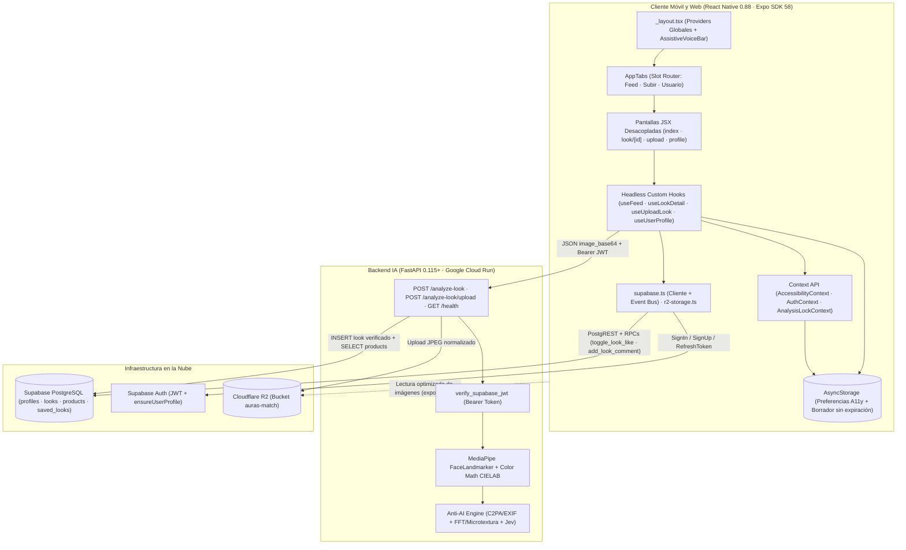
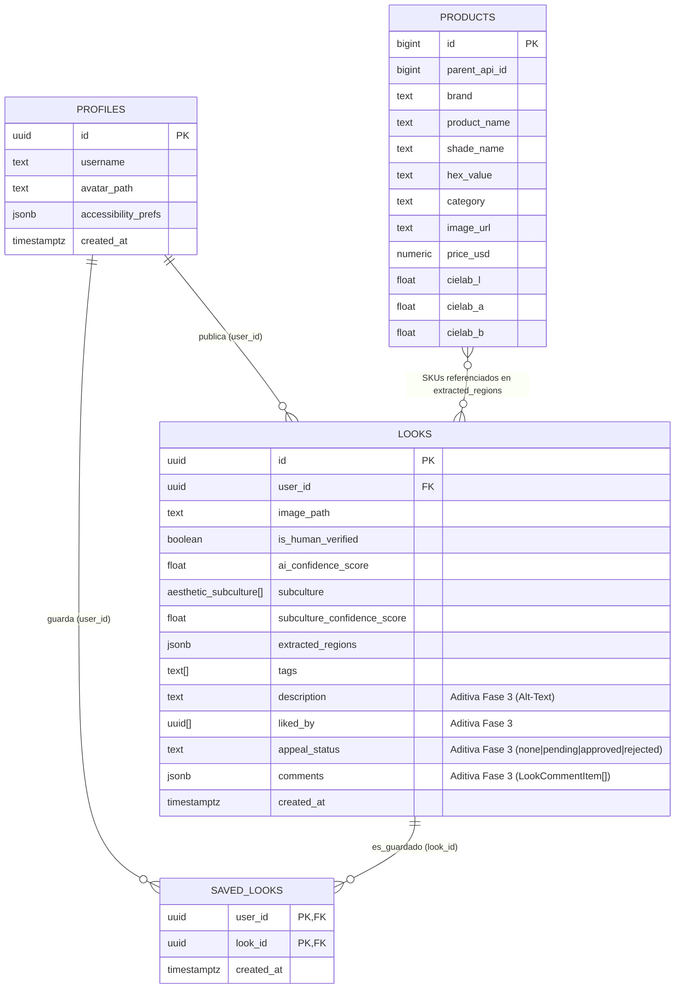

# **AurasMatch: Plataforma Móvil de Descubrimiento Estético y Recomendación Personalizada de Cosméticos Basada en Visión por Computadora**

**Entrega Final (Fase 3) — Despliegue de Producto, Accesibilidad Móvil y Arquitectura End-to-End**

**Autores:**  
Kenny Kaven Fang Cen (`kennyface@unisabana.edu.co`)  
Diego Eduardo Escalante García (`diegoescga@unisabana.edu.co`)  

**Institución:** Universidad de La Sabana — Facultad de Ingeniería Informática  
**Asignatura:** Desarrollo de Aplicaciones Móviles  

---

> ***Resumen (Abstract)*** — **AurasMatch** es una aplicación móvil multiplataforma (React Native / Expo para iOS, Android y Web) orientada al descubrimiento visual de maquillaje real y a la recomendación personalizada de cosméticos mediante visión por computadora. Frente a la proliferación de contenido sintético generado por inteligencia artificial (*AI slop*), la saturación publicitaria y la ausencia de herramientas para identificar tonos reales, el sistema integra en un mismo flujo: (1) un **motor híbrido Anti-IA de tres etapas** (metadatos C2PA/EXIF, forense espectral y de microtextura facial, y análisis visual-semántico), (2) clasificación en cinco subculturas estéticas (*Jirai Kei, Clean Girl, Goth, E-Girl, Y2K*) mediante un modelo de decisión visual (**Jev**), y (3) segmentación facial en cuatro regiones anatómicas con **MediaPipe FaceLandmarker** y emparejamiento perceptual en espacio **CIELAB ($\Delta E$)** contra un catálogo de 3,085 tonos cosméticos en Supabase. Sobre estos cimientos de la Fase 1, la arquitectura incorpora íntegramente las 16 promesas de accesibilidad universal formuladas en la Fase 2 conforme a las pautas **WCAG 2.1 / 2.2 Nivel AA y AAA**.
>
> ***Index Terms*** — visión por computadora, descubrimiento visual, recomendación de cosméticos, accesibilidad móvil, WCAG 2.1/2.2, análisis facial, detección anti-IA, React Native, Expo.

---

## **Sección 1: Consolidación de Visión del Producto, Problema y Estado del Arte (Evolución Fase 1)**

### 1.1. Resumen Ejecutivo, Propuesta de Valor y *User Personas*

* **Nombre del proyecto:** AurasMatch
* **Eslogan:** *La primera red de descubrimiento estético y recomendación de cosméticos impulsada por visión por computadora, libre de contenido sintético, generado por IA y saturación publicitaria.*
* **Propósito:** Reducir la brecha entre la inspiración digital de maquillaje y su recreación física en el mundo real, permitiendo explorar looks verificados como 100% humanos, filtrarlos por subcultura, zona del rostro y color perceptual, y descomponer fotografías propias para obtener cosméticos equivalentes comprables.

#### *User Personas* Consolidadas (Fases 1 y 2)

| Perfil | Descripción y Contexto | Necesidades y Puntos de Dolor | Cómo Responde AurasMatch |
| :--- | :--- | :--- | :--- |
| **1. Usuario Primario (Entusiasta Gen Z / Millennial)** | Consumidores de maquillaje activos en subculturas visuales (*Jirai Kei, Clean Girl, Goth, E-Girl, Y2K*), nativos digitales familiarizados con redes sociales y compras en línea. | Frustración ante contenido sintético irreplicable (*AI slop*), falta de etiquetado de subculturas de nicho, exceso de anuncios e incertidumbre sobre qué tonos físicos se usaron. | Feed filtrado estrictamente a origen humano (`is_human_verified = true`), Filtro Triple y recomendaciones de SKUs por zona facial. |
| **2. Usuario Secundario (Maquillador / Creador / Marca)** | Artistas independientes, creadores de belleza y marcas de cosméticos con foco en e-commerce y analítica estética. | Pérdida de alcance orgánico frente a granjas de contenido sintético y expectativas irreales generadas por imágenes retocadas/IA; riesgo de falsos positivos en moderación automática. | Atribución directa a productos reales del catálogo, transparencia técnica de verificación y **mecanismo de apelación humana** (`appeal_status`). |
| **3. Usuario con Necesidades de Accesibilidad (Consolidación Fase 2)** | Personas con **motricidad limitada** (uso exclusivo de teclado/switches o un solo toque), **diversidad cognitiva** (dislexia, fatiga por tiempo límite, epilepsia fotosensible), **diversidad auditiva** y **diversidad visual** (daltonismo, baja visión, fotofobia, uso de *TalkBack*/*VoiceOver*/*NVDA*). | Incapacidad de hacer *pinch-to-zoom*, pérdida de borradores por inactividad, textos pequeños que se recortan al ampliar, alertas solo sonoras, falta de *Alt-Text* en looks e imposibilidad de interpretar círculos de color sin etiquetas textuales. | Zoom discreto por botones, borradores sin expiración en `AsyncStorage`, fuentes para dislexia, escalado hasta 200%, alto contraste AAA (`21:1`), banners háptico-visuales, TTS y *Alt-Text* IA editable. |

---

### 1.2. Síntesis del Problema y Análisis Competitivo Actualizado

El descubrimiento visual de maquillaje enfrenta tres puntos de fricción documentados en la Propuesta de Fase 1:

1. **Inviabilidad práctica:** Los usuarios eligen referencias generadas por IA o fuertemente alteradas cuyos pigmentos y texturas resultan físicamente imposibles de replicar [8].
2. **Desalineación comercial y algorítmica:** Las redes generalistas saturan los feeds con publicidad intrusiva —el **71%** de los consumidores rechaza marcas percibidas como intrusivas según YouGov [3]— e ignoran subculturas de nicho.
3. **Dificultad en la identificación de productos:** La falta de herramientas para descomponer una fotografía obliga a adivinar tonos y acabados.

A escala de mercado, el sector de tecnología aplicada a la belleza proyecta alcanzar **USD\$172.9 mil millones para 2030** (CAGR de **17.9%**) [1], [2]. Sin embargo, el rechazo al contenido artificial crece rápidamente: Meltwater registra un aumento de nueve veces en menciones de *"AI slop"* con **54%** de sentimiento negativo [4]; Raptive reporta una caída del **14%** en la intención de compra ante contenido percibido como IA [4]; y estudios de la Universidad de Aalto y sobre sobrecarga informacional confirman menor satisfacción y fatiga de usuario [5], [6], [7].

#### Tabla 1. Matriz Comparativa de Competidores vs. AurasMatch Final

| Plataforma | Enfoque Principal | Experiencia de Usuario | Modelo / Alcance | Brechas frente a AurasMatch Final |
| :--- | :--- | :--- | :--- | :--- |
| **SkinSort** | Análisis de ingredientes y rutinas orientado a *skincare*. | Búsqueda centrada en compatibilidad de ingredientes y puntajes. | Freemium con afiliados y anuncios. | Orientado al cuidado de la piel, no a estética visual de maquillaje, subculturas ni análisis facial por foto. |
| **Dupe AI** | Búsqueda de alternativas económicas (*dupes*) desde una foto. | El usuario sube una foto para hallar productos equivalentes más baratos. | Freemium con compras en la app (*Dupe Pro*). | Orientado a *dupes* individuales sin comunidad verificada anti-IA, sin taxonomía subcultural ni accesibilidad adaptativa. |
| **Temptalia** | Reseñas, *swatches* y comparaciones de tonos por texto. | Orientado a investigación cuando el usuario ya conoce el producto o marca. | Contenido con anuncios y enlaces de afiliado. | No permite descubrir looks desde cero por subcultura ni extraer tonos automáticamente desde selfies. |
| **Pinterest** | Descubrimiento visual generalista mediante *Pins* y tableros. | Búsqueda por texto/imagen entre millones de referencias mezcladas. | Gratuito con saturación publicitaria. | Invadido por contenido sintético [8], sin clasificación cosmética precisa ni extracción automatizada de SKUs. |
| **AurasMatch (Producto Final)** | **Red de descubrimiento estético real + CV + Accesibilidad Universal.** | Feed 100% humano, Filtro Triple, análisis por región facial en foto propia, detalles en popup y accesibilidad AA/AAA. | Libre de anuncios intrusivos; atribución directa a catálogo real de 3,085 SKUs en Supabase. | **Integra en un único sistema**: filtro híbrido Anti-IA de 3 etapas, clasificación subcultural, extracción CIELAB por zonas y cumplimiento WCAG 2.1/2.2. |

---

### 1.3. Innovación Lograda y Pivotes de Ingeniería Frente al Estado del Arte

Durante el paso de la investigación conceptual (Fase 1) al producto desplegado en nube (Fases 2 y 3), el equipo ejecutó **cuatro pivotes técnicos fundamentados en eficiencia móvil y latencia en producción**:

1. **De segmentación pesada (`BiSeNet` / `SegFace`) a `MediaPipe FaceLandmarker` con máscaras de exclusión poligonal (`backend/app/cv/mediapipe_cv.py`):**  
   En lugar de ejecutar redes de segmentación semántica pesadas sobre CPU en contenedores sin GPU —lo que elevaría el costo computacional advertido en la Sección IV.C de la propuesta—, se adoptó **`face_landmarker.task` (468 landmarks 3D)**. Con polígonos anatómicos positivos y negativos (`LIP_OUTER_POLYGON` menos `LIP_INNER_POLYGON` para `lips`; arcos ciliares para `brows`; párpados superiores para `eyelids`; línea de pestañas excluyendo esclerótica en `lash_line`), se aíslan con exactitud los píxeles de maquillaje reduciendo drásticamente latencia y falsos muestreos sobre dientes u ojos.
2. **De *fine-tuning* local de `CLIP` al motor visual-semántico `Jev` (`jev-latest`, `backend/app/cv/vision_api.py`):**  
   Para clasificar las 5 subculturas emergentes del MVP (`Jirai Kei`, `Clean Girl`, `Goth`, `E-Girl`, `Y2K`) y detectar pistas semánticas de síntesis sin mantener un modelo multimodal pesado en memoria del backend, se integró la consulta asíncrona estructurada a `jev-latest` en paralelo con el emparejamiento de SKUs (`asyncio.gather`).
3. **Emparejamiento perceptual `CIELAB ΔE` (CIE76) + traducción semántica accesible (`backend/app/cv/color_math.py` y `frontend/src/utils/color-names.ts`):**  
   Las regiones segmentadas se transforman de `sRGB` a espacio perceptual **CIE $L^*a^*b^*$** bajo iluminante D65 y se comparan por distancia euclidiana $\Delta E = \sqrt{(\Delta L^*)^2 + (\Delta a^*)^2 + (\Delta b^*)^2}$ contra las 6 categorías de `public.products`. Adicionalmente, el cliente traduce cualquier valor `HEX` a nombres descriptivos en español (*"Rojo carmín intenso"*, *"Vino / Ciruela oscuro"*, etc.) para usuarios con daltonismo o lectores de pantalla.
4. **Filtro Anti-IA Híbrido de 3 Etapas y Transporte Móvil Resiliente (`backend/app/cv/anti_ai.py`, `frontend/src/hooks/use-upload-look.ts`):**  
   Para mitigar el riesgo de falsos positivos en piel suave o iluminaciones blandas (Sección IV.C del Proposal):
   * **Etapa 1 (Procedencia activa):** inspección de firmas C2PA/EXIF de generadores (`trainedAlgorithmicMedia`, Midjourney, Flux, DALL-E, ComfyUI) y metadatos de cámaras reales (`digitalCapture`, Apple, Samsung, Sony, Canon).
   * **Etapa 2 (Forense pasivo CV):** análisis espectral FFT en dominio de frecuencias junto con forense anatómico de microtextura en parches de mejillas (`LEFT/RIGHT_CHEEK_POLYGON`), frente (`FOREHEAD_SKIN_POLYGON`) y referencia periocular (`plasticity_penalty`, entropía de paso alto y correlación residual entre canales RGB).
   * **Etapa 3 (Fusión multimodal y umbral `0.50`):** combinación ponderada con `vision_ai_score` de `Jev`. Si `ai_confidence_score >= 0.50`, la publicación queda retenida fuera del Feed principal (`is_human_verified = false`) pero aparece en el perfil del autor con el botón **Solicitar apelación humana** (`appeal_status = 'pending'`).
   * En transporte móvil, el frontend envía la imagen codificada en **JSON Base64 (`POST /analyze-look` con `upload_to_r2: true`)** para evitar el error nativo `unsupported formdatapart implementation` observado en React Native `0.88` al usar `FormData` multiparte.

---

## **Sección 2: Arquitectura de Software Móvil e Implementación Técnica**

### 2.1. Diagrama de Arquitectura End-to-End

---

### 2.2. Decisiones Arquitectónicas, Navegación y Gestión de Estado

1. **Estructura Modular en Expo Router (`frontend/src/app/`) y Barra de 3 Pestañas basada en `<Slot />`:**  
   En lugar de depender del componente `<Tabs>` basado en `useVisibleTabsWithRedirect` —que provocaba redirecciones prematuras al navegar hacia rutas dinámicas de detalle como `/look/[id]`—, [`app-tabs.tsx`](../frontend/src/components/app-tabs.tsx) utiliza `<Slot />` junto a `usePathname()` y `useRouter()`. Esto conserva una barra inferior fija, predecible y accesible con tres destinos (**`Feed`**, **`Subir`**, **`Usuario`**) y habilita su bloqueo seguro mediante `AnalysisLockContext` mientras corre un análisis en Cloud Run.
2. **Separación Estricta Lógica vs. UI (*Headless Custom Hooks* / Arquitectura *"Stitch-Ready"*):**  
   Ninguna pantalla JSX realiza consultas crudas a Supabase o FastAPI. Toda la lógica asíncrona reside en `useFeed`, `useLookDetail`, `useUploadLook`, `useUserProfile`, `useAuth` y `useAccessibility`. Este desacoplamiento permite actualizar la capa visual sin romper reglas de negocio y facilita una futura migración interna hacia Redux Toolkit si la complejidad de estado creciera.
3. **Sincronización Reactiva Cross-Screen (`subscribeLookDataChanges`):**  
   Dado que `AppTabs` con `<Slot />` desmonta/remonta rutas al cambiar de pestaña y la versión utilizada de `expo-router` (`~58.0.28`) no expone `useFocusEffect`, [`supabase.ts`](../frontend/src/services/supabase.ts) implementa un bus ligero de eventos en memoria (`like`, `save`, `comment`, `description`, `appeal`, `created`) que mantiene sincronizados al instante los estados entre `Feed`, `Detalle` y `Perfil`.
4. **Almacenamiento Seguro de Sesión y Persistencia Local:**  
   `@supabase/supabase-js` mantiene `persistSession: true` y `autoRefreshToken: true` sin cierres abruptos de sesión; además, `AccessibilityContext` persiste preferencias en `@aurasmatch/accessibility_prefs_v1` y `useUploadLook` guarda borradores indefinidamente en `@aurasmatch/upload_look_draft_v1` sin límite de tiempo.
5. **Optimización de Rendimiento en Listas y Red:**  
   - [`index.tsx`](../frontend/src/app/index.tsx) renderiza el feed con `FlatList` usando `key` dinámica entre 2 columnas y 1 columna ancha según escalado tipográfico ($\ge 150\%$).
   - [`use-user-profile.ts`](../frontend/src/hooks/use-user-profile.ts) ejecuta en paralelo mediante `Promise.all` las consultas de publicaciones propias, publicaciones con *like* (`liked_by` `cs`) y publicaciones guardadas (`saved_looks`), deduplicando filas en memoria e hidratando nombres de autor (`fetchProfileUsernamesMap`) en una sola petición agrupada `.in('id', validIds)`.
   - En el backend (`backend/app/main.py`), MediaPipe corre en hilo separado (`asyncio.to_thread`) y la recuperación de SKUs en Supabase corre concurrentemente con la clasificación en `Jev` (`asyncio.gather`).

---

### 2.3. Modelo de Datos y Contratos de Servicio

La base de datos PostgreSQL en Supabase opera sobre **cuatro tablas relacionales** (`frontend/src/types/database.ts`), extendiendo `public.looks` de forma aditiva con valores por defecto para mantener compatibilidad intacta con el backend en Cloud Run:

#### Seguridad RLS y Funciones RPC Atómicas (`docs/supabase-rls-and-rpcs.sql`)
Durante la auditoría previa a la entrega se detectó que, aunque `products`, `profiles`, `saved_looks` y las operaciones `SELECT`/`INSERT`/`DELETE` de `looks` contaban con políticas RLS operativas, `public.looks` carecía de política `UPDATE` (devolviendo 0 filas en `PATCH`) y faltaba la RPC `add_look_comment`. Para resolverlo en una sola corrida sin alterar `auth.users` ni las políticas existentes:
* **Permisos y política `"looks_update_own"` (`FOR UPDATE TO authenticated`):** habilita al propietario (`auth.uid() = user_id`) actualizar `description` (Alt-Text en publicación Cloud Run o edición posterior) y `appeal_status`.
* **Trigger `protect_look_verification_columns` (`trg_protect_look_verification`):** impide que clientes con rol `anon`/`authenticated` alteren `user_id`, `is_human_verified` o `ai_confidence_score`, permitiendo únicamente `description` y transiciones de apelación (`appeal_status` en `'none'`/`'pending'`).
* **RPCs `SECURITY DEFINER` (`toggle_look_like(uuid)` y `add_look_comment(uuid, jsonb)`):** permiten a cualquier usuario autenticado dar *Me gusta* o publicar comentarios sobre looks de terceros sin exponer escritura directa sobre `liked_by` o `comments`, seguidas de `NOTIFY pgrst, 'reload schema'`.
* **Alta idempotente de perfiles (`ensureUserProfile()` en cliente):** garantiza la existencia de la fila en `public.profiles` al iniciar sesión o registrarse, sin requerir triggers sobre `auth.users`.

#### Contratos de API REST del Microservicio (`backend/app/main.py`)
* `GET /health`: verificación de disponibilidad del servicio.
* `POST /analyze-look` *(Requiere `Authorization: Bearer <supabase_access_token>`)*: recibe `{ image_url | image_base64, upload_to_r2, r2_folder }`, valida identidad JWT, segmenta con MediaPipe, calcula colores CIELAB y SKUs cercanos, ejecuta `Jev` + motor Anti-IA de 3 etapas, sube a Cloudflare R2 e inserta en `public.looks`. Devuelve `422 Unprocessable Entity` si MediaPipe no detecta los 468 landmarks faciales y `401` si el token expiró.
* `POST /analyze-look/upload`: variante multiparte binaria disponible en el servidor; el cliente móvil emplea `POST /analyze-look` en Base64 JSON por estabilidad multiplataforma en React Native `0.88`.

---

## **Sección 3: Implementación y Auditoría de Accesibilidad Móvil (Consolidación Fase 2)**

### 3.1. Cumplimiento WCAG 2.1 / 2.2 Nivel AA y AAA y Regla Móvil-Primero

1. **Semántica Nativa para TalkBack / VoiceOver / NVDA + Guardas de Plataforma:**  
   La UI aplica estrictamente la **Regla Multiplataforma Móvil-Primero**: las vistas móviles usan únicamente roles nativos válidos de React Native (`button`, `tab`, `switch`, `search`, `header`, `alert`, `text`), protegiendo atributos exclusivos de WAI-ARIA Web (como `role="dialog"`, `role="alert"`, `aria-modal`, `tabIndex`) mediante `Platform.OS === 'web'`. Esto previene cierres fatales de `RCTViewManager` en Android/iOS (por ejemplo, el uso inválido de `accessibilityRole="region"` en nativo). Además, tarjetas complejas como `LookCard` exponen `accessibilityActions` (`activate`, `like`, `save`, `speak`) para operar acciones clave sin recorrer múltiples nodos hijos.
2. **Diseño Visual, Contraste Verificado y Tipografía Adaptativa (`frontend/src/constants/theme.ts` y `themed-text.tsx`):**  
   * **Paleta Claro (WCAG AA/AAA):** texto `#111318` sobre `#FFFFFF` (**18.5:1**), texto secundario `#4A4E58` (**7.1:1** sobre blanco, **6.2:1** sobre tarjeta), primario `#8E1B4E` (**7.8:1**), enlace `#0052CC` (**7.3:1**), éxito/advertencia/peligro superiores a **6.1:1**.
   * **Paleta Oscura (WCAG AA/AAA):** texto `#F7F8FA` sobre `#0B0C0E` (**19.6:1**), secundario `#B8BDC7` (**9.8:1**), primario `#FF85B3` (**8.9:1**).
   * **Modo Alto Contraste (WCAG AAA):** fondo `#000000`, texto `#FFFFFF` (**21:1**), acento secundario `#FFFF00` (**19.6:1**), primario `#00FFFF` (**16.7:1**) y bordes sólidos `#FFFFFF`.
   * **Prevención de recorte tipográfico (*clipping*) y escalado al 200%:** `ThemedText` calcula proporcionalmente `scaledFontSize` y `scaledLineHeight` con `maxFontSizeMultiplier={2.0}`, sumando un incremento de interlineado de `+0.12` cuando está activa la fuente para dislexia. En el Feed, al alcanzar escala $\ge 150\%$ o pantalla estrecha ($< 340\text{ px}$), la cuadrícula conmuta de 2 columnas a 1 columna ancha.
   * **Independencia del color (WCAG 1.4.1):** `ColorSwatchBadge` oculta el círculo decorativo al lector (`importantForAccessibility="no"`, `aria-hidden={true}`) y presenta nombre descriptivo en español + código `HEX`.
3. **Ergonomía Táctil, Navegación Predecible y Feedback Multimodal:**  
   * `MinTouchTargetSize = 48` dp ($\ge 44\times 44\text{ pt}$) más `DEFAULT_HIT_SLOP` de `8` dp en todos los botones implementados sobre `AccessiblePressable`.
   * Anillo de foco de alto contraste (`focusRing` de `2px`) al navegar por teclado (`onFocus`/`onBlur`).
   * Patrón unificado **`AccessibleCollapsible` (WCAG 2.4.1 *Bypass Blocks*)**: los comentarios comunitarios y el filtro flotante permiten omitirse con un solo desplazamiento/tabulación cuando permanecen plegados.
   * **`VisualAlertBanner`**: unifica alerta visual con borde de severidad, vibración háptica (`expo-haptics` / `navigator.vibrate`) y anuncio al lector (`AccessibilityInfo.announceForAccessibility`).

---

### 3.2. Matriz Trazable Completa (Propuesta Corte 2 vs. Implementación Final)

La siguiente matriz traza **cada una de las 16 promesas** definidas en la Sección V de `2ndPhaseProposal.pdf` hasta su implementación verificada en el código fuente:

| Categoría y Promesa (Corte 2) | Criterio WCAG | Archivo(s) y Líneas Exactas de Implementación | Mecanismo Implementado | Estado |
| :--- | :--- | :--- | :--- | :--- |
| **A.1 Navegación completa por teclado** (`Tab`, flechas, `Enter`, foco visible) | 2.1.1, 2.4.7 | [`accessible-pressable.tsx`](../frontend/src/components/ui/accessible-pressable.tsx#L108-L149), [`app-tabs.tsx`](../frontend/src/components/app-tabs.tsx#L60-L120), [`product-detail-modal.tsx`](../frontend/src/components/look/product-detail-modal.tsx#L82-L94), [`triple-filter-dropdown.tsx`](../frontend/src/components/feed/triple-filter-dropdown.tsx#L61-L77) | `tabIndex`, mapeo `onFocus`/`onBlur` con anillo visible `focusRing` de `2px` y cierre por tecla `Escape` en modales/paneles Web. | Implementado |
| **A.2 Compatibilidad con tecnologías de asistencia** (switches, joysticks, eye-tracking) | 4.1.2, 2.1.1 | [`accessible-pressable.tsx`](../frontend/src/components/ui/accessible-pressable.tsx#L121-L151), [`look-card.tsx`](../frontend/src/components/feed/look-card.tsx#L42-L56) | Exposición explícita de `accessibilityRole`, `accessibilityState`, `accessibilityHint`, orden lógico de nodos y `accessibilityActions` en tarjetas. | Implementado |
| **A.3 Comandos de voz e integración con asistentes** (*"Publicar"*, *"Dar me gusta"*, etc.) | 2.5.3 (*Label in Name*) | [`assistive-voice-bar.tsx`](../frontend/src/components/ui/assistive-voice-bar.tsx#L31-L215), [`_layout.tsx`](../frontend/src/app/_layout.tsx#L21), [`accessibility-modal.tsx`](../frontend/src/components/accessibility/accessibility-modal.tsx#L345-L377), [`look/[id].tsx`](../frontend/src/app/look/%5Bid%5D.tsx#L258-L337) | Etiquetas programáticas alineadas con etiquetas visuales para *Voice Control* / *Voice Access* + paleta flotante activable `AssistiveVoiceBar` con atajos y guía nativa. | Implementado |
| **A.4 Zonas de interacción amplias** ($\ge 44 \times 44$ px) | 2.5.5, 2.5.8 | [`theme.ts`](../frontend/src/constants/theme.ts#L116), [`accessible-pressable.tsx`](../frontend/src/components/ui/accessible-pressable.tsx#L55) | Constante `MinTouchTargetSize = 48` dp aplicada por defecto en `AccessiblePressable` junto con `DEFAULT_HIT_SLOP` de `8` dp por lado. | Implementado |
| **A.5 Gestos alternativos** (zoom por botones en vez de *pinch* multi-dedo) | 2.5.1 (*Pointer Gestures*) | [`step-zoom-image.tsx`](../frontend/src/components/ui/step-zoom-image.tsx#L54-L56), [`step-zoom-image.tsx`](../frontend/src/components/ui/step-zoom-image.tsx#L142-L156), [`step-zoom-image.tsx`](../frontend/src/components/ui/step-zoom-image.tsx#L352-L410) | Botones táctiles discretos `- Zoom`, `+ Zoom` y `↺` (`100%` a `350%` en pasos de `50%`) coexistiendo con *pinch-to-zoom* y arrastre. | Implementado |
| **B.1 Fuentes aptas para dislexia** (Sans-Serif Verdana/Arial y Monospace Courier) | 1.4.8, Legibilidad [12] | [`theme.ts`](../frontend/src/constants/theme.ts#L90-L104), [`themed-text.tsx`](../frontend/src/components/themed-text.tsx#L50-L77), [`accessibility-modal.tsx`](../frontend/src/components/accessibility/accessibility-modal.tsx#L268-L311) | Selector entre `'default'`, `'sans_dyslexia'` (Verdana/Arial/Helvetica) y `'mono_dyslexia'` (Courier), sumando `+0.12` al ratio de `lineHeight`. | Implementado |
| **B.2 Control de animaciones** (evitar sobreestimulación y fotosensibilidad) | 2.3.3, 2.3.1 | [`accessibility-context.tsx`](../frontend/src/contexts/accessibility-context.tsx#L99-L111), [`collapsible.tsx`](../frontend/src/components/ui/collapsible.tsx#L85), [`accessibility-modal.tsx`](../frontend/src/components/accessibility/accessibility-modal.tsx#L314-L342) | Lectura automática de preferencia del SO (`AccessibilityInfo.isReduceMotionEnabled()`) + interruptor manual `reduced_motion`. | Implementado |
| **B.3 Lenguaje claro y diseño predecible** | 3.2.3, 3.2.4, 3.3.8 | [`app-tabs.tsx`](../frontend/src/components/app-tabs.tsx#L198-L230), [`profile.tsx`](../frontend/src/app/profile.tsx#L161-L199), [`auth-card.tsx`](../frontend/src/components/auth/auth-card.tsx#L156-L212) | 3 pestañas consistentes (`Feed`, `Subir`, `Usuario`), etiquetas visibles fijas sobre campos de texto y autenticación diferida (*Gradual Engagement*). | Implementado |
| **B.4 Cancelación de temporizadores** (sin expiración abrupta de formularios/sesión) | 2.2.1 (*Timing Adjustable*) | [`use-upload-look.ts`](../frontend/src/hooks/use-upload-look.ts#L40), [`use-upload-look.ts`](../frontend/src/hooks/use-upload-look.ts#L245-L281), [`comments-section-collapsible.tsx`](../frontend/src/components/look/comments-section-collapsible.tsx#L30-L41), [`supabase.ts`](../frontend/src/services/supabase.ts#L1-L110) | Autoguardado continuo en `AsyncStorage` (`@aurasmatch/upload_look_draft_v1`) sin caducidad, comentarios sin reloj y `autoRefreshToken: true`. | Implementado |
| **B.5 Sugerencias de búsqueda tolerantes a errores** | 3.3.3 (*Error Suggestion*) | [`fuzzy-search.ts`](../frontend/src/utils/fuzzy-search.ts#L19-L59), [`fuzzy-search.ts`](../frontend/src/utils/fuzzy-search.ts#L83-L159), [`index.tsx`](../frontend/src/app/index.tsx#L159-L186) | Normalización sin tildes + distancia de **Levenshtein** y chips predictivos interactivos ante errores como `"jiray"` o `"gotico"`. | Implementado |
| **C.1 Alertas visuales** (paridad visual, háptica y sonora en notificaciones/errores) | 1.3.3, 4.1.3 | [`visual-alert-banner.tsx`](../frontend/src/components/ui/visual-alert-banner.tsx#L56-L115), [`a11y-feedback.ts`](../frontend/src/utils/a11y-feedback.ts#L11-L42) | `VisualAlertBanner` con borde de severidad, icono, `accessibilityRole="alert"`, vibración `expo-haptics`/`navigator.vibrate` y anuncio TTS. | Implementado |
| **D.1 Texto descriptivo (*Alt-Text* editable + TTS + sugerencia IA)** | 1.1.1 (*Non-text Content*) | [`use-upload-look.ts`](../frontend/src/hooks/use-upload-look.ts#L107-L145), [`upload.tsx`](../frontend/src/app/upload.tsx#L411-L460), [`a11y-feedback.ts`](../frontend/src/utils/a11y-feedback.ts#L57-L88), [`use-look-detail.ts`](../frontend/src/hooks/use-look-detail.ts#L268-L315) | Generación automática en español basada en subcultura y tonos CIELAB + edición manual en `looks.description` + síntesis de voz TTS multiplataforma. | Implementado |
| **D.2 Compatibilidad con lectores de pantalla** (TalkBack, VoiceOver, NVDA + daltonismo) | 1.3.1, 1.4.1, 4.1.2, 4.1.3 | [`themed-text.tsx`](../frontend/src/components/themed-text.tsx#L78-L87), [`color-swatch-badge.tsx`](../frontend/src/components/ui/color-swatch-badge.tsx#L33-L65), [`color-names.ts`](../frontend/src/utils/color-names.ts#L91-L118), [`index.tsx`](../frontend/src/app/index.tsx#L201-L211), [`product-detail-modal.tsx`](../frontend/src/components/look/product-detail-modal.tsx#L136-L164) | Encabezados semánticos (`header`, `aria-level`), región viva `polite`, modal aislado (`accessibilityViewIsModal={true}`, `role="dialog"`) y traducción textual de color CIELAB. | Implementado |
| **D.3 Contraste de color regulable** ($\ge 4.5:1$ normal + Modo Alto Contraste) | 1.4.3, 1.4.6 | [`theme.ts`](../frontend/src/constants/theme.ts#L14-L60), [`accessibility-modal.tsx`](../frontend/src/components/accessibility/accessibility-modal.tsx#L200-L228) | Ratios verificados (18.5:1 claro, 19.6:1 oscuro) más tema **Alto Contraste AAA** (`#FFFFFF`/`#FFFF00`/`#00FFFF` sobre `#000000`, hasta **21:1**). | Implementado |
| **D.4 Diseño responsivo y escalado de texto hasta 200%** | 1.4.4 (*Resize Text*) | [`accessibility-context.tsx`](../frontend/src/contexts/accessibility-context.tsx#L53-L60), [`themed-text.tsx`](../frontend/src/components/themed-text.tsx#L52-L64), [`index.tsx`](../frontend/src/app/index.tsx#L85-L87), [`index.tsx`](../frontend/src/app/index.tsx#L351-L355) | `font_scale` de `100%` a `200%`, escalado conjunto de `lineHeight` y conmutación dinámica a 1 columna en Feed desde `150%`. | Implementado |
| **D.5 Modo Oscuro (*Dark Mode*)** para fotofobia y fatiga visual | Confort Visual (V.D) | [`theme.ts`](../frontend/src/constants/theme.ts#L30-L44), [`accessibility-context.tsx`](../frontend/src/contexts/accessibility-context.tsx#L63-L67) | Soporte automático al tema del sistema (`useColorScheme()`) y selección manual explícita de Modo Oscuro (`#0B0C0E` / `#F7F8FA`). | Implementado |

---

## **Sección 4: Pruebas Funcionales, Rendimiento y Validación de Usuario**

### 4.1. Verificaciones Técnicas Ejecutadas y Casos de Prueba Funcionales

Durante la integración de la Fase 3 se validaron tanto flujos principales (*happy paths*) como rutas de error y controles de integridad:

| Tipo de Prueba | Alcance y Escenario | Resultado Observado | Referencia en Código / Entorno |
| :--- | :--- | :--- | :--- |
| **Verificación Estática TypeScript** | Compilación estricta completa de `frontend/` (`npx tsc --noEmit`). | **Aprobado (código de salida `0`, 0 errores)** tras las ediciones finales de hooks, pantallas y servicios. | [`frontend/tsconfig.json`](../frontend/tsconfig.json) |
| **Auditoría de Secretos e Historial Git** | Búsqueda de llaves privadas (`sb_secret_`, claves R2) en archivos fuente, docs y diff de commit. | **Aprobado:** 0 credenciales codificadas en el repositorio; `.env` excluido en `.gitignore`. | [`r2-storage.ts`](../frontend/src/services/r2-storage.ts), [`supabase.ts`](../frontend/src/services/supabase.ts) |
| **Pruebas en Vivo contra Supabase** | Lectura de `public.looks`, autenticación JWT (`bot@aurasmatch.local`), lectura de `public.profiles` (`@aurasmatch_bot`) e inserción/eliminación en `saved_looks`. | **Aprobado:** autenticación `OK`, lectura de perfiles `OK`, ciclo `insert` + `delete` en `saved_looks` con `1` fila afectada. Se detectó bloqueo RLS previo en `looks` (resuelto mediante el script SQL de migración). | [`docs/supabase-rls-and-rpcs.sql`](supabase-rls-and-rpcs.sql) |
| **Flujo Feed y Filtro Triple** | Búsqueda con faltas de ortografía (`"jiray"`, `"gotico"`) y combinación de Subcultura + Zona facial + Color CIELAB; *Gradual Engagement* sin sesión. | Sugerencias Levenshtein muestran chips canónicos; filtro contextual cruza región con color $\Delta E$; tocar Like/Guardar sin sesión dispara modal de acceso sin bloquear navegación. | [`use-feed.ts`](../frontend/src/hooks/use-feed.ts), [`fuzzy-search.ts`](../frontend/src/utils/fuzzy-search.ts) |
| **Flujo Detalle, Popup y Comentarios** | Apertura de look, botones de Zoom (`StepZoomImage`), TTS, modal Anti-IA, popup `ProductDetailModal`, comentarios vacíos y válidos, y mini-feed similar. | Modal de producto abre sin cambiar de pantalla y cierra con `Escape`; comentarios vacíos muestran `VisualAlertBanner` de error sin temporizador de expiración; eventos sincronizan `Feed` y `Perfil`. | [`look/[id].tsx`](../frontend/src/app/look/%5Bid%5D.tsx), [`comments-section-collapsible.tsx`](../frontend/src/components/look/comments-section-collapsible.tsx) |
| **Flujo Subida y Manejo de Errores Backend** | Envío JSON Base64 a `POST /analyze-look`, bloqueo temporal de tabs (`AnalysisLock`), respuesta `422` (rostro no detectado) y error de red. | Bloqueo activo durante análisis; `422` activa banner específico de MediaPipe; desconexión habilita el botón de **Simulación Asistida** y conservación de borrador en `AsyncStorage`. | [`use-upload-look.ts`](../frontend/src/hooks/use-upload-look.ts), [`upload.tsx`](../frontend/src/app/upload.tsx) |

*(Nota de transparencia técnica: la ejecución de `npx expo lint` no se completó en el entorno aislado porque `frontend/package.json` no incluye configuración ni paquete local de ESLint y Expo CLI requiere acceso de red para autoinstalarlo).*

### 4.2. Protocolo de Auditoría de Accesibilidad en Dispositivo / Emulador

Para la demostración presencial y defensa técnica sobre dispositivo físico o emulador (Android TalkBack, iOS VoiceOver y teclado en navegador Web), se deja establecido el siguiente protocolo de inspección en vivo:

1. **Orden de foco por teclado (Web):** recorrer con `Tab` → barra de búsqueda → botón `⚙️` de filtros (`Enter` abre, `Escape` cierra) → tarjetas de look → pestañas inferiores, comprobando anillo visible `focusRing` en cada control y cero trampas de foco.
2. **Lectores de pantalla (TalkBack en Android / VoiceOver en iOS):**
   - Verificar que `LookCard` agrupa su lectura y expone acciones nativas (*Me gusta*, *Guardar*, *Escuchar*).
   - Verificar que `ColorSwatchBadge` anuncia el nombre del color en español + código `HEX` omitiendo el círculo visual.
   - Comprobar que `ProductDetailModal` y `AccessibilityModal` aíslan el foco mediante `accessibilityViewIsModal={true}` y que los banners de error se anuncian automáticamente vía `accessibilityLiveRegion`.
3. **Resiliencia visual al 200% y Alto Contraste:** elevar el tamaño de texto al `200%` en `Opciones de Accesibilidad` y confirmar la transición del Feed a 1 columna sin recorte de letras (`clipping`) ni superposición de botones, tanto en Modo Oscuro como en Modo Alto Contraste AAA.
4. **Asistencia Motriz y Voz:** activar la **Barra Asistida de Voz** y ejecutar comandos de navegación y lectura de contexto (`"Ir al Feed"`, `"Escuchar Pantalla"`).

---

## **Sección 5: Conclusiones, Limitaciones y Trabajo Futuro**

### 5.1. Balance Técnico y Retos de Ingeniería Superados

La implementación consolidada demuestra la viabilidad técnica planteada desde la Propuesta de Fase 1 y materializa de extremo a extremo la propuesta de accesibilidad del Segundo Corte sin recurrir a *mocks* rígidos ni sacrificar usabilidad móvil. Entre los retos de ingeniería reales resueltos durante el semestre destacan:

1. **Estabilidad Nativa en Android/iOS (`RCTViewManager`):** eliminar atributos ARIA exclusivos de Web (como `accessibilityRole="region"`) que provocaban cierres inmediatos en dispositivos nativos, centralizándolos detrás de `Platform.OS === 'web'` en primitivas reutilizables.
2. **Transporte de Imágenes en React Native `0.88`:** resolver la excepción `unsupported formdatapart implementation` mediante envío estructurado JSON Base64 hacia `POST /analyze-look` con carga automática a Cloudflare R2 desde el backend.
3. **Navegación con Detalle Dinámico (`/look/[id]`):** sustituir el contenedor `<Tabs>` con redirección automática por `<Slot />` en `AppTabs`, manteniendo la barra fija de 3 pestañas y deshabilitando transiciones durante el análisis IA.
4. **Consistencia y Seguridad en Base de Datos bajo JWT:** sustituir llamadas incompatibles con cliente móvil (`auth.admin`) y claves privadas por autenticación estándar, detección explícita de bloqueos RLS, triggers protectores de verificación Anti-IA y RPCs atómicas en PostgreSQL.

### 5.2. Limitaciones Actuales y Hoja de Ruta (*Roadmap*)

* **Limitaciones conocidas:** la activación completa de likes/comentarios multiusuario con llave pública `anon` requiere ejecutar una única vez [`docs/supabase-rls-and-rpcs.sql`](supabase-rls-and-rpcs.sql) en Supabase Dashboard; el flujo de apelación humana registra actualmente el estado `pending` en base de datos, quedando pendiente una consola administrativa dedicada para moderadores; la suite automatizada de pruebas unitarias/E2E y la configuración local de ESLint quedan fuera del alcance del MVP actual.
* **Trabajo Futuro:**
  1. **Panel de Moderación Anti-IA:** interfaz para revisores humanos que permita aprobar o rechazar solicitudes con `appeal_status = 'pending'`.
  2. **Capa Visual con Google Stitch:** aprovechar la arquitectura *Headless Custom Hooks* para aplicar un rediseño estético de alta fidelidad sin alterar lógica de negocio ni atributos semánticos.
  3. **Escalado de Estado y Catálogo:** migrar gradualmente el interior de los hooks hacia Redux Toolkit/Zustand si crece la complejidad de estado en sesiones colaborativas, y ampliar la base de productos de 3,085 SKUs hacia cobertura multipaís e integración de comercio afiliado.
  4. **Automatización CI/CD:** incorporar linters locales (ESLint + Prettier) y pruebas de regresión accesibles automatizadas en cada *pull request*.

---

## **Referencias (Formato IEEE)**

[1] Grand View Research, “Beauty Tech Market Size, Share & Growth Report, 2025–2030,” Grand View Research, 2026. [En línea]. Disponible: https://www.grandviewresearch.com/industry-analysis/beauty-tech-market-report

[2] “The Role of Marketing Research in Understanding Consumer Behavior and Preferences,” ResearchGate, 2024. [En línea]. Disponible: https://www.researchgate.net/publication/380888546_The_Role_of_Marketing_Research_in_Understanding_Consumer_Behavior_and_Preferences

[3] “Ads on social media have crossed a tipping point, says expert,” Silicon Republic. [En línea]. Disponible: https://www.siliconrepublic.com/business/social-media-ads-ai-meta-youtube-instagram-suhas-vijayakumar-ucd

[4] C. O’Brien, “Is AI Slop the New Brand Risk?,” Digital Marketing Institute, jun. 23, 2026. [En línea]. Disponible: https://digitalmarketinginstitute.com/blog/is-ai-slop-the-new-brand-risk

[5] K. Logan, L. F. Bright, y S. L. Grau, “Unfriend me, please!: Social media fatigue and the theory of rational choice,” *Journal of Marketing Theory and Practice*, vol. 26, no. 4, pp. 357–367, 2018, doi: 10.1080/10696679.2018.1488219.

[6] “Impact of AI-Generated Content on User Satisfaction and Time Spent on Digital Platforms,” Aaltodoc. [En línea]. Disponible: https://aaltodoc.aalto.fi/bitstreams/9ecb40ce-3a5a-4fbc-bbd7-7132a5d372b0/download

[7] M. Liu, “Trust Vortex in Content Design for Social Media Platforms from the Perspective of Generative AI: An Empirical Study on Xiaohongshu’s Algorithmic Seeding Ecology,” Atlantis Press, 2025. [En línea]. Disponible: https://www.atlantis-press.com/article/126019086.pdf

[8] “How AI is Ruining Pinterest and Why It Matters for Businesses,” Local Partnership Joint Market Solutions. [En línea]. Disponible: https://localpartnershipjointmarketsolutions.com/MEDIA/how-ai-is-ruining-pinterest-and-why-it-matters-for-businesses

[9] Level Access, “Keyboard Navigation: The Complete Web Accessibility Guide.” [En línea]. Disponible: https://www.levelaccess.com/blog/keyboard-navigation-complete-web-accessibility-guide/

[10] W3C Web Accessibility Initiative (WAI), “Understanding Success Criterion 2.5.5: Target Size.” [En línea]. Disponible: https://www.w3.org/WAI/WCAG21/Understanding/target-size.html

[11] W3C Web Accessibility Initiative (WAI), “Understanding Success Criterion 2.5.1: Pointer Gestures.” [En línea]. Disponible: https://www.w3.org/WAI/WCAG21/Understanding/pointer-gestures.html

[12] L. Rello y R. Baeza-Yates, “Good Fonts for Dyslexia,” en *Proceedings of the 15th International ACM SIGACCESS Conference on Computers and Accessibility (ASSETS)*, 2013, pp. 1–8. [En línea]. Disponible: https://www.researchgate.net/publication/262320823_Good_fonts_for_dyslexia

[13] Y. Inal, S. Shalawadi, y E. Papachristos, “Legally Mandated, but Still Inaccessible: Digital Tensions in Older Adults’ Use of Norwegian Web Services,” en *Adjunct Proceedings of the 14th Nordic Conference on Human-Computer Interaction (NordiCHI ’26 Adjunct)*, 2026. [En línea]. Disponible: https://arxiv.org/pdf/2608.12552

[14] W3C Web Accessibility Initiative (WAI), “Understanding Guideline 2.3: Seizures.” [En línea]. Disponible: https://www.w3.org/TR/UNDERSTANDING-WCAG20/seizure.html

[15] W3C Web Accessibility Initiative (WAI), “How People with Disabilities Use the Web: Auditory Disabilities.” [En línea]. Disponible: https://www.w3.org/WAI/people-use-web/abilities-barriers/auditory/#examples-of-barriers-for-people-with-auditory-disabilities

[16] W3C Web Accessibility Initiative (WAI), “Understanding Success Criterion 1.1.1: Non-text Content.” [En línea]. Disponible: https://www.w3.org/WAI/WCAG21/Understanding/non-text-content

[17] WCAG.com, “How to Write Good Alt Text.” [En línea]. Disponible: https://wcagc.com/blog/how-to-write-good-alt-text

[18] Section 508, “Fonts and Typography.” [En línea]. Disponible: https://www.section508.gov/develop/fonts-typography/
