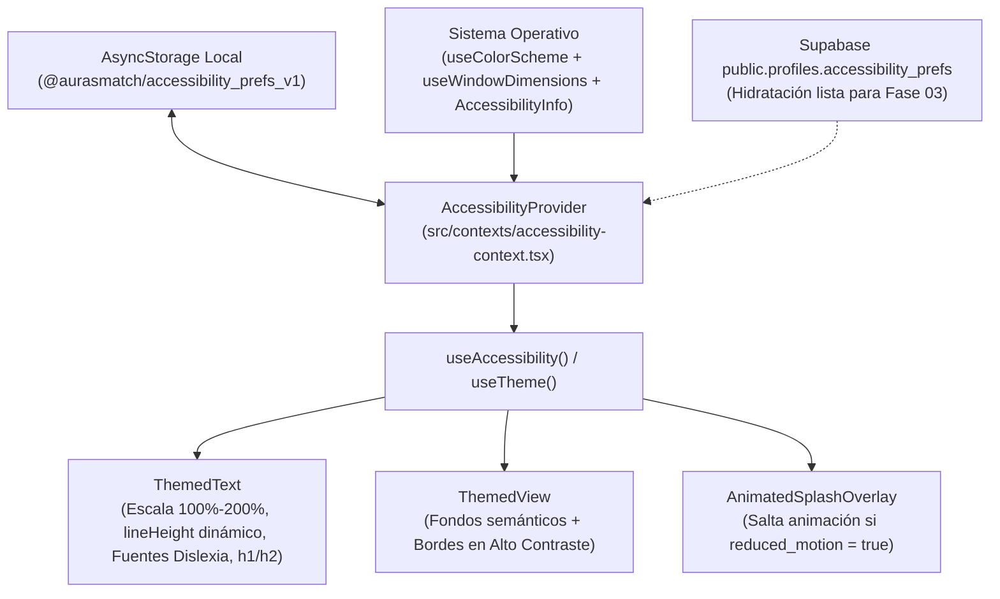

# Documentación Técnica Profunda — Fase 01: Motor de Accesibilidad, Temas, Traducción de Color y Tipografía Adaptativa

> **Ubicación en el SDD:** [`docs/specs/01-accessibility-and-theme.md`](../specs/01-accessibility-and-theme.md)  
> **Conexión con el Temario del Curso (`agente-desarrollo-movil.md`):** Semana 2 (`useState` como snapshot, `useEffect` con cleanup de suscripciones nativas), Semana 3 (`useWindowDimensions` reactivo), Semana 6 (Accesibilidad Móvil A11y, contraste, texto escalable y `reduceMotion`) y Semana 7 (Design Tokens semánticos y componentes multiplataforma).

---

## 1. Visión General: ¿Qué hace la Fase 01 en el conjunto del proyecto?

En una aplicación móvil tradicional, los colores y tamaños de letra suelen estar quemados (*hardcoded*) en cada pantalla. Eso hace imposible cumplir con dos requisitos centrales de **AurasMatch**:
1. **Accesibilidad Inclusiva en Tiempo Real (Promesas de `2ndPhaseProposal.pdf` + Rúbrica Fase 3):** El usuario debe poder alternar en vivo entre **Modo Claro**, **Modo Oscuro** y **Modo de Alto Contraste (WCAG AAA $\ge 7:1$)**, activar **Fuentes Aptas para Dislexia** (*Sans-Serif Arial/Verdana* o *Monoespaciada Courier*), escalar el tamaño del texto hasta un **200%** sin que se recorten las letras (*clipping*), y **Desactivar Animaciones** para prevenir epilepsia fotosensible.
2. **Independencia del Color en Cosméticos (WCAG 1.4.1 — Uso del Color):** Como el backend extrae colores de maquillaje en formato hexadecimal (`#3b3735`), una persona con daltonismo o que usa un lector de pantalla (*TalkBack, VoiceOver o NVDA*) no puede depender solo de ver el círculo pintado ni de escuchar un código hexadecimal crudo. La Fase 01 introduce un motor matemático en el cliente que convierte cualquier código `HEX` al espacio perceptual `CIELAB`, calcula la distancia euclidiana $\Delta E$ contra 11 familias cromáticas de cosméticos y devuelve su nombre descriptivo en español (ej. `"Negro / Carbón oscuro (#3B3735)"`).

---

## 2. Explicación Detallada Archivo por Archivo (De lo General a lo Específico)

### 2.1. [`frontend/src/utils/color-names.ts`](../../frontend/src/utils/color-names.ts) — Traductor Perceptual `HEX` $\rightarrow$ `CIELAB` $\rightarrow$ Español

#### ¿Qué problema resuelve?
El espacio `RGB / HEX` no es perceptualmente uniforme: dos colores con distancia matemática cercana en `RGB` pueden verse muy distintos para el ojo humano. Para traducir un color `#RRGGBB` extraído por el backend (o perteneciente a uno de los 3,085 productos de Supabase) a un nombre en español comprensible, este módulo replica en TypeScript la misma matemática física del backend ([`backend/app/cv/color_math.py`](../../backend/app/cv/color_math.py)):

#### Desglose de Funciones y Constantes Específicas:
* **`hexToRgb(hex: string)`:** Limpia el prefijo `#`, valida mediante expresión regular `/^[0-9a-fA-F]{6}$/` que sea un hexadecimal válido de 6 dígitos y extrae los canales enteros $[R, G, B] \in [0, 255]$.
* **`hexToCielab(hex: string)`:**
  1. **Corrección Gamma Inversa (Linealización sRGB):** Aplica la función de transferencia estándar IEC 61966-2-1:
     $$C_{\text{lin}} = \begin{cases} \left(\frac{C + 0.055}{1.055}\right)^{2.4} & \text{si } C > 0.04045 \\ \frac{C}{12.92} & \text{en otro caso} \end{cases}$$
  2. **Transformación a CIE XYZ bajo Iluminante Estándar D65:** Multiplica $[R_{\text{lin}}, G_{\text{lin}}, B_{\text{lin}}]$ por la matriz de transformación sRGB y normaliza por el punto blanco de referencia D65 ($X_n = 95.047, Y_n = 100.0, Z_n = 108.883$).
  3. **Proyección no lineal a coordenadas $[L^*, a^*, b^*]$:** Donde $L^*$ representa la luminosidad perceptual ($0$ negro a $100$ blanco), $a^*$ el eje verde–rojo y $b^*$ el eje azul–amarillo.
* **`computeDeltaE(lab1, lab2)`:** Calcula la distancia euclidiana perceptual CIE76:
  $$\Delta E^*_{ab} = \sqrt{(\Delta L^*)^2 + (\Delta a^*)^2 + (\Delta b^*)^2}$$
* **`COLOR_FAMILIES`:** Catálogo tipado de 11 familias cromáticas cosméticas (*Negro/Carbón, Marrón cacao, Nude/Beige, Rojo carmín, Vino/Ciruela, Rosa/Frambuesa, Coral/Durazno, Morado/Lavanda, Azul profundo, Verde esmeralda, Dorado/Bronce*) con sus coordenadas `CIELAB` precalculadas al iniciar el módulo.
  * **Doble propósito arquitectónico:** Además de dar nombre accesible a los tonos, esta constante será reutilizada en la **Fase 05** para poblar el tercer eje (Color) del **Filtro Triple** en la barra de búsqueda sin duplicar lógica.
* **`getSpanishColorName(hex)` y `formatAccessibleColorLabel(hex)`:** Buscan la familia en `COLOR_FAMILIES` con menor $\Delta E$ respecto al color recibido y devuelven `"Vino / Ciruela oscuro (#5B1E31)"`.

---

### 2.2. [`frontend/src/constants/theme.ts`](../../frontend/src/constants/theme.ts) — Sistema de Design Tokens Semánticos y Tipografía

#### ¿Qué problema resuelve? (Conexión con Semana 6 y Semana 7 de `agente-desarrollo-movil.md`)
Como se estudia en la **Semana 7 (Design Tokens)**, usar colores hexadecimales sueltos en las vistas impide soportar múltiples temas y auditar el contraste. Además, en la plantilla original de Expo, el color `linkPrimary` (`#3c87f7`) sobre fondo blanco (`#ffffff`) tenía una relación de contraste de **`3.48:1`**, incumpliendo el mínimo de **`4.5:1`** exigido por **WCAG 2.1 Nivel AA** en la rúbrica del profesor.

#### Desglose Técnico:
* **Objeto `Colors` con 3 Paletas Semánticas (`light`, `dark`, `high_contrast`):**
  * **`light`:** Texto principal `#111318` sobre `#FFFFFF` (`18.5:1`), texto secundario `#4A4E58` (`7.1:1` sobre blanco y `6.2:1` sobre superficies `#F2F3F7`), acento primario `#8E1B4E` (`7.8:1`) y enlaces `#0052CC` (`7.3:1`). Todos superan ampliamente el estándar AA ($\ge 4.5:1$).
  * **`dark`:** Optimizado para fotofobia y baja luz (Promesa D.5 de `2ndPhaseProposal.pdf`), con fondo `#0B0C0E`, texto `#F7F8FA` (`19.6:1`) y secundario `#B8BDC7` (`9.8:1`).
  * **`high_contrast`:** Cumple la Promesa D.3 (*"Modo de alto contraste"*) y el nivel **WCAG AAA ($\ge 7.0:1$)** usando fondo negro puro `#000000`, texto blanco `#FFFFFF` (`21:1`), texto secundario amarillo `#FFFF00` (`19.6:1`), controles primarios cian `#00FFFF` (`16.7:1`) y bordes blancos definidos `#FFFFFF`.
* **`DyslexiaFontFamilies`:** Mapea las 3 variantes tipográficas (`default`, `sans_dyslexia`, `mono_dyslexia`) por plataforma (`Platform.select`) hacia las fuentes exactas respaldadas por Rello & Baeza-Yates `[12]` en `2ndPhaseProposal.pdf` (*Verdana / Arial / Helvetica* y *Courier*).
* **`MinTouchTargetSize = 48`:** Constante global que fija el estándar mínimo de área táctil de $48 \times 48\text{ dp}$ ($\ge 44 \times 44\text{ pt}$) para toda la aplicación.

---

### 2.3. [`frontend/src/contexts/accessibility-context.tsx`](../../frontend/src/contexts/accessibility-context.tsx) y [`use-accessibility.ts`](../../frontend/src/hooks/use-accessibility.ts) — Estado Global Desacoplado

#### ¿Qué problema resuelve? (Conexión con Semana 2, 3, 4 y 13 de `agente-desarrollo-movil.md`)
Centraliza todas las preferencias de accesibilidad en un `React Context` expuesto mediante el Custom Hook `useAccessibility()`, manteniendo una estructura JSON idéntica a la columna `public.profiles.accessibility_prefs` de Supabase.

#### Decisiones de Ingeniería Importantes para la Defensa Oral (40%):
1. **Sincronización con sistemas externos mediante `useEffect` y Cleanup (Semana 2 y 4):**
   * Al montar `AccessibilityProvider`, el `useEffect` ejecuta en paralelo (`Promise.all`) la lectura de `AsyncStorage.getItem(STORAGE_KEY)` y la consulta al sistema operativo nativo `AccessibilityInfo.isReduceMotionEnabled()`.
   * Se suscribe al evento nativo `AccessibilityInfo.addEventListener('reduceMotionChanged', ...)` y **retorna la función de limpieza (`motionSubscription.remove()`)** en el cleanup del efecto para evitar fugas de memoria (*memory leaks*) si el árbol se desmonta.
2. **Actualizaciones funcionales de estado (`setPrefs(prev => ...)` — Semana 2):**
   * En `updateAccessibilityPrefs`, el nuevo estado se calcula de forma pura a partir del snapshot `prev` y mantiene sincronizados los campos acoplados (por ejemplo, si `high_contrast` pasa a `true`, `theme_mode` pasa automáticamente a `'high_contrast'`; si `dyslexia_font` pasa a `false`, `font_family_variant` regresa a `'default'`).
3. **Medición reactiva con `useWindowDimensions` (Semana 3):**
   * En lugar de usar `Dimensions.get('window')` estático (que no reacciona si el usuario cambia el tamaño de letra en los ajustes del sistema operativo mientras la app está abierta), consume `const { fontScale: systemFontScale } = useWindowDimensions()`.
4. **Preparado para Supabase (`hydrateFromProfilePrefs`):**
   * Expone una función lista para que en la **Fase 03**, apenas el usuario inicie sesión, el JSON guardado en `public.profiles.accessibility_prefs` hidrate el estado local y persista en `AsyncStorage`.

---

### 2.4. [`frontend/src/components/themed-text.tsx`](../../frontend/src/components/themed-text.tsx) y [`themed-view.tsx`](../../frontend/src/components/themed-view.tsx) — Renderizado Adaptativo

#### ¿Qué hace `ThemedText` exactamente?
1. **Escalado Tipográfico Dinámico sin Recorte (*Clipping*):**
   * Toma el `fontSize` base de la variante (`small: 14`, `default: 16`, `subtitle: 24`, `title: 36`, `code: 12`) y lo multiplica por `prefs.font_scale` (de `1.0` hasta `2.0`).
   * **Cálculo de `lineHeight` proporcional (Requisito explícito de la Rúbrica):** En React Native, si agrandas `fontSize` pero dejas un `lineHeight` fijo o ausente, las letras con trazos ascendentes/descendentes (como `g`, `j`, `p`, `y`, `Á`) se cortan por arriba o por abajo. `ThemedText` calcula en cada render:
     $$\text{lineHeight} = \lceil \text{scaledFontSize} \times (\text{lineHeightRatio} + \text{dyslexiaLineBoost}) \rceil$$
     garantizando siempre entre $1.35\times$ y $1.62\times$ de altura de línea incluso al **200%**.
2. **Modo Dislexia Activo:**
   * Cuando `prefs.dyslexia_font` es `true`, inyecta la familia tipográfica seleccionada (`sans_dyslexia` o `mono_dyslexia`), añade `letterSpacing: 0.6` y aumenta el `lineHeight` un `12%` adicional para reducir el efecto de apiñamiento visual (*visual crowding*).
3. **Semántica Multiplataforma para Lectores de Pantalla (Móvil + Web):**
   * Si `type` es `'title'` o `'subtitle'`, asigna automáticamente `accessibilityRole="header"` (para iOS VoiceOver y Android TalkBack) y `aria-level={1 | 2}` (para que `react-native-web` renderice encabezados semánticos navegables con NVDA en Windows).

#### ¿Qué hace `ThemedView` exactamente?
* Aplica el color de fondo correspondiente de la paleta activa (`palette[type ?? 'background']`).
* Si el usuario activa el **Modo de Alto Contraste (`resolvedThemeKey === 'high_contrast'`)**, cualquier contenedor de tarjeta o elemento (`backgroundElement` o `backgroundSelected`) recibe automáticamente un borde de `1.5px` de alto contraste (`palette.border = '#FFFFFF'`) para delimitar visualmente las zonas de la interfaz sin depender de sombras sutiles.

---

### 2.5. [`frontend/src/components/animated-icon.tsx`](../../frontend/src/components/animated-icon.tsx) y [`_layout.tsx`](../../frontend/src/app/_layout.tsx)
* **`_layout.tsx`:** Envuelve toda la aplicación dentro de `<AccessibilityProvider>` para que cualquier pantalla, modal o tab tenga acceso inmediato a `useAccessibility()` y `useTheme()`.
* **`animated-icon.tsx`:** Consume `const { prefs } = useAccessibility()`. Si `prefs.reduced_motion` es `true`, oculta de inmediato el `SplashScreen` y omite la animación elástica de escala/rotación (cumpliendo la Promesa B.2 de `2ndPhaseProposal.pdf` sobre control de animaciones y epilepsia fotosensible).

