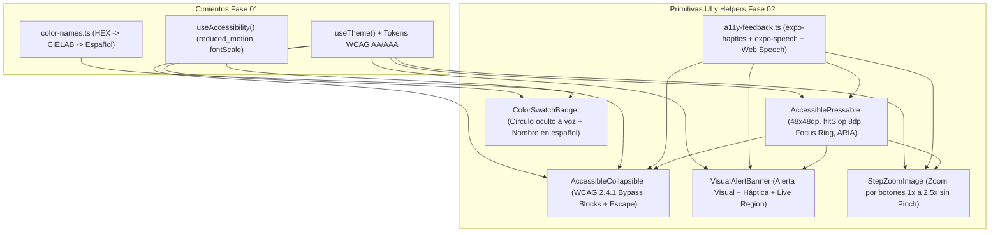

# Documentación Técnica Profunda — Fase 02: Primitivas UI Accesibles Multiplataforma ("Stitch-Ready")

> **Ubicación en el SDD:** [`docs/specs/02-ui-primitives.md`](../specs/02-ui-primitives.md)  
> **Conexión con el Temario del Curso (`agente-desarrollo-movil.md`):** Semana 2 (`useEffect` con cleanup de listeners DOM en Web), Semana 3 (`Pressable` con estados interactivos `pressed`/`focused`), Semana 6 (Accesibilidad Móvil A11y: `accessibilityRole`, `accessibilityLabel`, `accessibilityHint`, `accessibilityState`, áreas táctiles $\ge 44\times 44\text{ pt}$ y `hitSlop`), Semana 7 (Componentes atómicos reutilizables basados en *Design Tokens*) y Semana 10 (Animaciones condicionadas a `reduced_motion`).

---

## 1. Visión General: ¿Qué hace la Fase 02 en el conjunto del proyecto?

En lugar de repetir propiedades complejas de accesibilidad (`accessibilityRole`, `accessibilityState`, `aria-expanded`, `hitSlop`, anillos de foco por teclado, vibración háptica y síntesis de voz) en cada pantalla de la aplicación, la **Fase 02** construye **6 piezas atómicas reutilizables** (patrón de *Primitivas UI*).

Esto resuelve **tres objetivos estratégicos** al mismo tiempo:
1. **Cumplimiento transversal de `2ndPhaseProposal.pdf` (Móvil + Web):** Todas las pantallas que construyamos en las Fases 04 a 08 heredarán automáticamente áreas táctiles de $48\times 48\text{ dp}$, soporte de teclado (`Tab`, `Enter`, `Espacio`, `Escape`), lectores de pantalla (*TalkBack, VoiceOver y NVDA*), paridad visual/háptica para personas sordas y nombres de color descriptivos para personas con daltonismo.
2. **Patrón Unificado de Menú Desplegable (`AccessibleCollapsible` — WCAG 2.4.1 *Bypass Blocks*):** Implementa una sola vez el componente desplegable que usaremos en **(a)** el botón del Filtro Triple junto a la barra de búsqueda del Feed, **(b)** el Menú de Opciones de Accesibilidad en el Perfil de Usuario, **(c)** el Desglose Técnico Anti-IA y Comentarios en el Detalle del Look, y **(d)** la Guía de Iluminación en la pantalla de Subir Look.
3. **Arquitectura *"Stitch-Ready"*:** Al separar la semántica de accesibilidad en primitivas limpias (`AccessiblePressable`, `AccessibleCollapsible`, `VisualAlertBanner`, `StepZoomImage`, `ColorSwatchBadge`), cuando apliques **Google Stitch** al finalizar el flujo funcional solo tendrás que retocar los estilos de estas 5 primitivas sin tocar la lógica ni romper la accesibilidad.



---

## 2. Explicación Detallada Archivo por Archivo (De lo General a lo Específico)

### 2.1. [`frontend/src/utils/a11y-feedback.ts`](../../frontend/src/utils/a11y-feedback.ts) — Motor Multiplataforma de Retroalimentación Háptica y Voz (`Text-to-Speech`)

* **Propósito General:** Proveer funciones seguras que funcionen tanto en **iOS/Android nativo** (usando los módulos nativos `expo-haptics` y `expo-speech`) como en **Web** (usando `navigator.vibrate` y la API estándar `window.speechSynthesis`), sin lanzar excepciones si el dispositivo no tiene motor de vibración.
* **Detalle de Funciones Implementadas:**
  1. **`triggerHapticFeedback(type: HapticFeedbackType = 'light')`:**
     * En móvil nativo (`Platform.OS !== 'web'`), invoca `Haptics.impactAsync` (`Light`, `Medium`) para toques de botones normales y `Haptics.notificationAsync` (`Success`, `Warning`, `Error`) para confirmaciones de *Like/Guardado* o alertas de error del filtro Anti-IA.
     * En Web (`Platform.OS === 'web'`), verifica si `navigator.vibrate` existe y emite un pulso corto (`15 ms`) o doble (`[25, 40, 25]`) en errores.
     * Envuelto en un bloque `try / catch` silencioso para evitar caídas en emuladores o dispositivos sin hardware háptico.
  2. **`speakDescription(text, options)` y `stopSpeaking()`:**
     * Cumple la promesa **V.D.1 (*Voice-to-Speech*)** de `2ndPhaseProposal.pdf`.
     * Antes de iniciar una lectura nueva, llama siempre a `stopSpeaking()` para evitar que múltiples toques encimen voces.
     * En iOS/Android ejecuta `Speech.speak(cleanText, { language: 'es-ES', rate: 0.98, ... })`.
     * En Web instancia `new window.SpeechSynthesisUtterance(cleanText)` con `lang = 'es-ES'` y conecta los callbacks `onstart`, `onend` y `onerror`.
  3. **`isCurrentlySpeaking()`:**
     * Devuelve una promesa booleana indicando si el sintetizador está hablando actualmente (útil para alternar el botón entre *"🔊 Escuchar descripción"* y *"⏹️ Detener lectura"*).
  4. **`announceStatus(message)`:**
     * Invoca `AccessibilityInfo.announceForAccessibility(message)` para que *TalkBack* o *VoiceOver* lean en voz alta cambios de estado dinámicos (ej. *"Menú de filtros desplegado"*, *"Zoom al 150 por ciento"*).

---

### 2.2. [`frontend/src/components/ui/accessible-pressable.tsx`](../../frontend/src/components/ui/accessible-pressable.tsx) — Botón Base con Área Táctil Segura y Foco por Teclado

* **Propósito General:** Reemplazar el `<Pressable>` crudo de React Native por un componente que garantice por defecto las reglas de **Motricidad Limitada** (`2ndPhaseProposal.pdf` Sección V.A) y de la **Semana 6 del curso** (`agente-desarrollo-movil.md`).
* **Cómo funciona internamente:**
  1. **Tamaño Táctil Mínimo ($48 \times 48\text{ dp}$) + `hitSlop` de $8\text{ dp}$:**
     * Aplica `minWidth: 48` y `minHeight: 48` (`MinTouchTargetSize` definido en `theme.ts`, superando el mínimo de $44 \times 44\text{ pt}$ exigido en la Semana 6) y un margen invisible de captura táctil `hitSlop={{ top: 8, bottom: 8, left: 8, right: 8 }}` para prevenir toques accidentales en personas con temblores o parálisis cerebral.
  2. **Sincronización Móvil + Web (WAI-ARIA):**
     * Exige por TypeScript la propiedad obligatoria `accessibilityLabel: string`.
     * En móvil pasa `accessibilityRole`, `accessibilityLabel`, `accessibilityHint`, `accessibilityState`, `accessibilityActions` y `onAccessibilityAction`.
     * En Web (`Platform.OS === 'web'`) inyecta automáticamente `'aria-label'`, `'aria-expanded'`, `'aria-selected'`, `'aria-busy'`, `'aria-disabled'` y `tabIndex={0}` (o `-1` si está deshabilitado).
  3. **Anillo de Foco Visible por Teclado (`isFocused`):**
     * Escucha los eventos `onFocus` y `onBlur`. Cuando un usuario navega con la tecla `Tab`, activa `isFocused = true` y dibuja un borde de $2\text{ px}$ con `theme.focusRing` (`#0052CC` en claro, `#66B2FF` en oscuro y amarillo `#FFFF00` en alto contraste).
  4. **Confirmación Háptica Automática:**
     * Al presionar (`handlePress`), si el botón no está deshabilitado, dispara `triggerHapticFeedback(hapticOnPress)` antes de ejecutar `onPress`.

---

### 2.3. [`frontend/src/components/ui/collapsible.tsx`](../../frontend/src/components/ui/collapsible.tsx) — Menú Desplegable Accesible (`AccessibleCollapsible`)

* **Propósito General:** Implementar el patrón **WAI-ARIA Disclosure / WCAG 2.4.1 (*Bypass Blocks*)** acordado para mantener las pantallas limpias y permitir que usuarios de teclado o lectores de pantalla salten bloques grandes de opciones si no desean usarlos.
* **Cómo funciona internamente:**
  1. **Modo Controlado y No Controlado:**
     * Puede usarse de forma simple (`defaultExpanded={false}`) o controlada desde la pantalla padre (`expanded={isOpen}` + `onExpandedChange={setIsOpen}`), e incluye soporte para `subtitle` (ej. resumen de filtros activos) y `badgeText` (ej. contador `"3"` de filtros aplicados).
  2. **Salto de Foco (*Bypass Blocks*):**
     * Mientras `isOpen === false`, el contenido interno **no se monta en el árbol de renderizado** (`{isOpen ? <ContentContainer>...</ContentContainer> : null}`). Esto garantiza al 100% que al navegar con `Tab` o *swipe* de lector de pantalla, si el usuario no presiona `Enter` sobre el encabezado, el foco salta inmediatamente al siguiente bloque principal de la pantalla sin quedar atrapado en decenas de controles ocultos.
  3. **Soporte de Tecla `Escape` con *Cleanup* (Semana 2 del curso):**
     * En Web, un `useEffect` registra `window.addEventListener('keydown', handleKeyDown)` solo cuando el menú está abierto (`isOpen === true`). Si el usuario presiona `Escape`, cierra el menú y anuncia el cambio. El `return () => window.removeEventListener(...)` limpia el listener al cerrarse o desmontarse.
  4. **Respeto a `reduced_motion` (Semana 6 y Semana 10 del curso):**
     * Lee `prefs.reduced_motion` de `useAccessibility()`. Si el usuario activó *Reducir animaciones*, renderiza un `<View>` instantáneo en lugar de `<Animated.View entering={FadeIn.duration(180)}>`.

---

### 2.4. [`frontend/src/components/ui/visual-alert-banner.tsx`](../../frontend/src/components/ui/visual-alert-banner.tsx) — Banner de Alerta Visual, Háptica y de Lector de Pantalla

* **Propósito General:** Cumplir la promesa de **Diversidad Auditiva** (`2ndPhaseProposal.pdf` Sección V.C) y la **Sección 3 de la Rúbrica Final** (*"retroalimentación háptica/auditiva/visual clara ante errores o estados de carga"*).
* **Cómo funciona internamente:**
  * Soporta 4 niveles semánticos: `'info' | 'success' | 'warning' | 'error'`, seleccionando el color de acento verificado del tema (`theme.primary`, `theme.success`, `theme.warning`, `theme.danger`) y un ícono visual explícito (`ℹ️`, `✅`, `⚠️`, `⛔`) para no depender solo del color.
  * Al montarse (`useEffect`), dispara automáticamente la vibración háptica correspondiente (`triggerHapticFeedback`) y anuncia el mensaje por voz (`announceStatus`), además de marcar el contenedor con `accessibilityRole="alert"`, `accessibilityLiveRegion="assertive"` (en errores) o `"polite"`, y `'aria-live'` en Web.
  * Permite incluir un botón de acción primaria (`actionLabel` + `onActionPress`, ideal para *"Reintentar"* o *"Apelar revisión"*) y un botón de cierre (`onDismiss`).

---

### 2.5. [`frontend/src/components/ui/step-zoom-image.tsx`](../../frontend/src/components/ui/step-zoom-image.tsx) — Visor de Imagen con Zoom por Botones de Un Solo Toque

* **Propósito General:** Cumplir la promesa de **Gestos Alternativos** (`2ndPhaseProposal.pdf` Sección V.A.4): permitir inspeccionar de cerca el maquillaje de ojos y labios sin obligar al usuario a realizar el gesto complejo de pellizcar con dos dedos (*pinch-to-zoom*).
* **Cómo funciona internamente:**
  * Define 4 escalones discretos de acercamiento: `ZOOM_STEPS = [1, 1.5, 2, 2.5]`.
  * Renderiza la imagen con `expo-image` dentro de un contenedor con `overflow: 'hidden'` y aplica `transform: [{ scale: currentZoom }]`.
  * Debajo de la foto presenta una barra de herramientas (`accessibilityRole="toolbar"`) con 3 botones `AccessiblePressable` de $\ge 48\text{ dp}$: **`− Alejar`**, **`1x` (Restablecer)** y **`+ Acercar`**, anunciando en voz alta el porcentaje de zoom en cada toque (`"Zoom al 150 por ciento"`).

---

### 2.6. [`frontend/src/components/ui/color-swatch-badge.tsx`](../../frontend/src/components/ui/color-swatch-badge.tsx) — Insignia Accesible de Tono Cosmético

* **Propósito General:** Cumplir la promesa de **Independencia del Color** (`2ndPhaseProposal.pdf` Sección V.D.2 y WCAG 1.4.1) tanto en las 4 regiones faciales extraídas (`lips`, `brows`, `eyelids`, `lash_line`) como en el Popup de Producto de los 3,085 SKUs.
* **Cómo funciona internamente:**
  * Toma cualquier código `hexValue` (ej. `"#B28378"`) y opcionalmente el nombre de la región (`regionLabel`, ej. `"Labios"`).
  * El círculo pintado con el color tiene `importantForAccessibility="no"` y `aria-hidden={true}` para que los lectores de pantalla lo ignoren por ser decorativo.
  * El contenedor padre agrupa semánticamente la información con `accessibilityLabel={formatAccessibleColorLabel(normalizedHex, regionLabel)}` y muestra en texto visible el nombre perceptual en español calculado por `CIELAB` (`getSpanishColorName`) junto al código hexadecimal (`"Nude / Beige suave (#B28378)"`).

---

## 3. Preguntas Frecuentes para la Defensa Técnica Individual (40% de la Nota)

1. **Profesor: *"¿Cómo garantizan en el código que ningún botón viole el tamaño mínimo táctil de accesibilidad ni falle con lectores de pantalla?"***
   * **Respuesta:** *"En lugar de usar `<Pressable>` suelto en cada pantalla, creamos la primitiva [`AccessiblePressable`](../../frontend/src/components/ui/accessible-pressable.tsx) en la Fase 02. Este componente exige por compilación de TypeScript la propiedad `accessibilityLabel`, aplica por defecto `minWidth: 48` y `minHeight: 48` dp junto con un `hitSlop` de 8 dp en los 4 lados, dibuja un anillo de foco de alto contraste cuando recibe foco por teclado (`onFocus`) y dispara retroalimentación háptica mediante [`a11y-feedback.ts`](../../frontend/src/utils/a11y-feedback.ts)."*
2. **Profesor: *"¿Cómo resolvieron el problema de accesibilidad cuando una pantalla tiene muchos filtros u opciones (como el Filtro Triple o el Menú de Accesibilidad) para que un usuario de teclado o TalkBack no tenga que pasar por 20 botones antes de ver el contenido?"***
   * **Respuesta:** *"Implementamos el patrón WAI-ARIA Disclosure (WCAG 2.4.1 Bypass Blocks) en [`AccessibleCollapsible`](../../frontend/src/components/ui/collapsible.tsx). Cuando el menú está contraído (`isOpen === false`), su encabezado expone `accessibilityState={{ expanded: false }}` y los controles internos no se montan en el árbol. Así, si el usuario no presiona Enter o doble toque para abrirlo, el foco salta directamente al Feed principal. Además, en Web registramos un listener de teclado con cleanup en `useEffect` para permitir cerrarlo con la tecla `Escape`."*


---

## 4. Cómo Probar la Implementación de la Fase 02 Paso a Paso

1. **Verificación de Compilación TypeScript (`npx tsc --noEmit`):**
   * En la terminal ejecuta:
     ```bash
     cd frontend
     npx tsc --noEmit
     ```
   * **Resultado esperado:** `0` errores de compilación en las 6 primitivas (`a11y-feedback.ts`, `accessible-pressable.tsx`, `collapsible.tsx`, `visual-alert-banner.tsx`, `step-zoom-image.tsx` y `color-swatch-badge.tsx`).

2. **Prueba Visual e Interactiva en `npx expo start` (Móvil Expo Go y Web):**
   * Corre `cd frontend && npx expo start` y abre la pestaña **Explore** (`src/app/explore.tsx`), donde ya están conectadas las secciones desplegables (`Collapsible` / `AccessibleCollapsible`):
     * **Prueba del Menú Desplegable (`AccessibleCollapsible`):**
       * **En Móvil:** Toca cualquiera de los encabezados desplegables. Sentirás una vibración háptica suave (`expo-haptics`) y la tarjeta se desplegará o contraerá suavemente (o de forma instantánea si `reduced_motion` está activo).
       * **En Web (Teclado):** Presiona la tecla `Tab` hasta enfocar el encabezado del desplegable $\rightarrow$ verás el **anillo de foco de alto contraste (`focusRing` de `2px`)**. Si vuelves a presionar `Tab` sin abrirlo, el foco salta directamente al siguiente bloque (*WCAG 2.4.1 Bypass Blocks*). Si presionas `Enter` o `Espacio`, se abre; y si presionas la tecla `Escape`, se cierra automáticamente.
     * **Prueba de `StepZoomImage`, `ColorSwatchBadge`, `VisualAlertBanner` y `speakDescription` (Voz):**
       * Estas primitivas se conectan directamente en las pantallas de **Feed (Fase 05)**, **Detalle del Look (Fase 06)** y **Subir Look (Fase 07)**, o pueden probarse desde el bloque de demostración interactiva en la pestaña secundaria.
