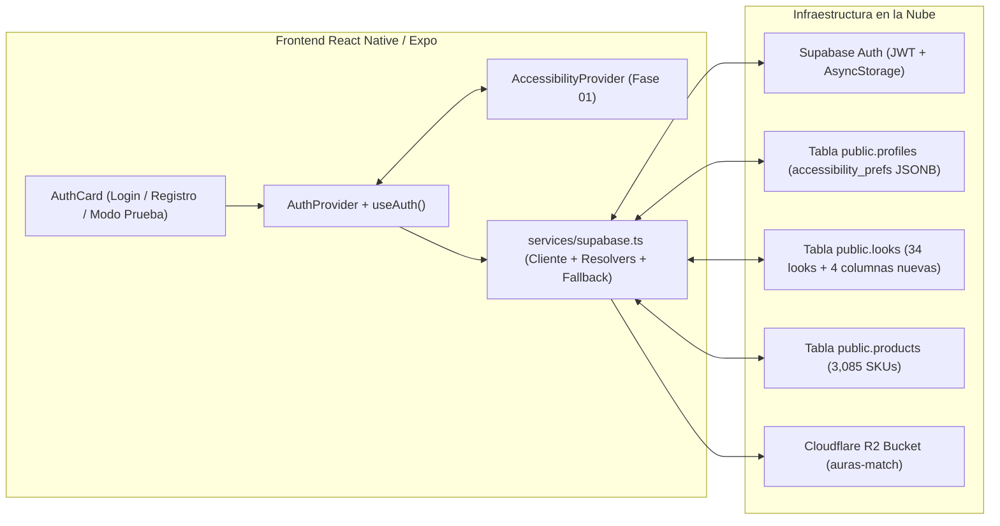

# Documentación Técnica Profunda — Fase 03: Base de Datos (Forma 2), Cliente Supabase/R2 y Autenticación

> **Ubicación en el SDD:** [`docs/specs/03-supabase-and-auth.md`](../specs/03-supabase-and-auth.md)  
> **Alineación con las 3 Reglas del Proyecto (`docs/projectProposalDocs/`):**
> * [`Course Project Phase 3`](../projectProposalDocs/Course%20Project%20Phase%203%20-%20Entrega%20Final%20(Proyecto%20Final%20Desarrollo%20Móvil).md): Sección 3 (Integración real con Supabase y sin secretos quemados en el cliente).
> * [`Project Proposal.pdf`](../projectProposalDocs/Project%20Proposal.pdf): Esquema de 5 subculturas estéticas, 4 regiones faciales (`lips`, `brows`, `eyelids`, `lash_line`) y recomendación de SKUs sobre los 3,085 cosméticos.
> * [`2ndPhaseProposal.pdf`](../projectProposalDocs/2ndPhaseProposal.pdf): Sección V.A.5 (Cancelación de temporizadores / sesiones sin expiración abrupta), Sección V.B (Formularios con etiquetas permanentes y mensajes de error claros) y sincronización de `accessibility_prefs`.

---

## 1. Visión General: ¿Qué hace la Fase 03 en el conjunto del proyecto?

La **Fase 03** conecta la aplicación móvil y web con la infraestructura real en la nube (**Supabase PostgreSQL + Supabase Auth + Cloudflare R2**), manteniendo el principio de **código compacto, cero tablas nuevas y 100% de protección automática (*fallback*)**:

1. **Esquema Aditivo en `public.looks` (Verificado en vivo sobre los 34 registros):**
   * Sin tocar las 10 columnas que utiliza el backend FastAPI en Google Cloud Run, la tabla `public.looks` ahora cuenta con 4 columnas adicionales con valor por defecto (`DEFAULT`):
     * `description text DEFAULT ''` (Texto descriptivo / Alt-Text accesible).
     * `liked_by uuid[] DEFAULT '{}'` (Arreglo de UUIDs de usuarios que dieron *Like*, independiente de la tabla `saved_looks`).
     * `appeal_status text DEFAULT 'none'` (Estado de apelación del filtro Anti-IA: `'none' | 'pending' | 'approved' | 'rejected'`).
     * `comments jsonb DEFAULT '[]'` (Lista estructurada de comentarios de la comunidad).
2. **Resolución Inteligente de Imágenes (`Cloudflare R2` y `Makeup API S3`):**
   * Convierte las rutas relativas guardadas en `looks.image_path` (ej. `"user_looks/8673b143...jpg"`) en URLs HTTPS completas, y corrige las URLs sin protocolo de `products.image_url` (`"//s3.amazonaws.com/..."` $\rightarrow$ `"https://s3.amazonaws.com/..."`).
3. **Autenticación Persistente sin Expiración Abrupta (`AuthProvider` + `useAuth`):**
   * Gestiona el ciclo de vida de la sesión de Supabase usando `AsyncStorage`, garantiza que todo usuario autenticado tenga su fila correspondiente en `public.profiles` (evitando errores de llave foránea) y sincroniza automáticamente sus preferencias de accesibilidad (`accessibility_prefs`) entre el dispositivo y la nube.



---

## 2. Explicación Detallada Archivo por Archivo (De lo General a lo Específico)

### 2.1. [`frontend/src/types/database.ts`](../../frontend/src/types/database.ts) — Contratos de Tipos Estrictos de la Base de Datos

* **Propósito General:** Reflejar en TypeScript la estructura exacta de las 4 tablas públicas de Supabase (`profiles`, `looks`, `products`, `saved_looks`) que inspeccionamos en vivo.
* **Detalle de Tipos y Constantes:**
  * **`AESTHETIC_SUBCULTURES`:** Tupla inmutable con las 5 subculturas oficiales del MVP (`'Jirai Kei'`, `'Clean Girl'`, `'Goth'`, `'E-Girl'`, `'Y2K'`).
  * **`FACIAL_REGIONS` y `FACIAL_REGION_LABELS`:** Mapea las 4 llaves técnicas del JSONB `extracted_regions` (`lips`, `brows`, `eyelids`, `lash_line`) a sus nombres legibles en español (*Labios*, *Cejas*, *Párpados / Sombras*, *Línea de Pestañas / Delineado*).
  * **`COSMETIC_CATEGORY_LABELS`:** Traduce las 6 categorías del catálogo (`lipstick`, `lip_liner`, `eyebrow`, `eyeshadow`, `eyeliner`, `mascara`) al español para el Filtro Triple y el Popup de Producto.
  * **`ProfileRow`, `LookRow`, `ProductRow`, `SavedLookRow`:** Interfaces exactas de las filas devueltas por PostgREST, incluyendo las 4 columnas aditivas de `looks` (`description`, `liked_by`, `appeal_status`, `comments`).

---

### 2.2. [`frontend/src/services/supabase.ts`](../../frontend/src/services/supabase.ts) — Cliente Supabase, Normalizadores de Imágenes y Respaldo Automático

* **Propósito General:** Centralizar toda la comunicación con Supabase y Cloudflare R2 en un único módulo, evitando que las pantallas hagan llamadas crudas o construyan URLs manualmente.
* **Detalle de Componentes Internos:**
  1. **`safeAuthStorage` (Adaptador SSR-Safe sobre `AsyncStorage`):**
     * En iOS y Android lee y escribe el token JWT en `AsyncStorage`.
     * En Web verifica primero `typeof window !== 'undefined'` antes de tocar `AsyncStorage`, evitando que el renderizado inicial de Expo Router falle en consola.
  2. **Instancia `supabase` (`createClient`):**
     * Configurada con `autoRefreshToken: true` y `persistSession: true`. Esto cumple la promesa de **Cancelación de temporizadores** de `2ndPhaseProposal.pdf` (Sección V.A.5): el usuario nunca pierde su sesión ni su trabajo por un límite de tiempo arbitrario.
  3. **`resolveLookImageUrl(imagePath, seedId)`:**
     * Si `imagePath` ya es una URL completa (`https://...`, `file://...` o `data:...`), la devuelve intacta.
     * Si es una ruta relativa de Cloudflare R2 (`"user_looks/8673b143...jpg"`) y `EXPO_PUBLIC_R2_PUBLIC_URL` está definida en `.env`, concatena el dominio público del bucket.
     * Si `EXPO_PUBLIC_R2_PUBLIC_URL` aún está vacía en `.env`, asigna de forma determinista una fotografía de retrato de respaldo para que las 34 publicaciones reales de la base de datos se puedan visualizar y probar sin cajas rotas.
  4. **`resolveProductImageUrl(imageUrl)`:**
     * En la tabla `public.products`, las 3,085 imágenes de Makeup API comienzan con `"//s3.amazonaws.com/..."` (URL relativa al protocolo). En un navegador web eso funciona, pero en React Native (`iOS/Android`) el componente `<Image />` rechaza URLs sin esquema explícito. Esta función antepone automáticamente `"https:"`.
  5. **`ensureUserProfile(userId, emailOrUsername)`:**
     * Consulta si el `userId` autenticado ya tiene su registro en `public.profiles`. Si no existe (por ejemplo, un usuario recién registrado), ejecuta un `upsert` creando su fila con `username` y `accessibility_prefs` por defecto. Así garantizamos que nunca falle la restricción de llave foránea `looks.user_id -> profiles.id`.
  6. **`syncAccessibilityPrefsToProfile(userId, prefs)`:**
     * Actualiza la columna `JSONB` `accessibility_prefs` en `public.profiles` cada vez que el usuario autenticado modifica su tema, contraste, fuente para dislexia o escala de texto.
  7. **`REAL_SUPABASE_MIRROR_LOOKS` y `REAL_SUPABASE_MIRROR_PRODUCTS` + `getLocalLookOverrides()`:**
     * Espejo de seguridad con registros reales extraídos de tu Supabase (`Look Goth #6290b685`, `Products #1, #2, #122, #267, #326, #440, #642, #751`) y almacenamiento local de interacciones para que puedas probar toda la app incluso antes de pegar `EXPO_PUBLIC_SUPABASE_ANON_KEY`.

---

### 2.3. [`frontend/src/contexts/auth-context.tsx`](../../frontend/src/contexts/auth-context.tsx) y [`frontend/src/hooks/use-auth.ts`](../../frontend/src/hooks/use-auth.ts) — Estado Global de Autenticación

* **Propósito General:** Exponer a toda la aplicación quién es el usuario actual (`user`, `profile`), si está autenticado (`isAuthenticated`), y las acciones de inicio de sesión, registro y cierre de sesión.
* **Cómo funciona internamente:**
  * **Restauración y Suscripción Reactiva con *Cleanup*:** Al iniciar la app llama a `supabase.auth.getSession()` y registra `supabase.auth.onAuthStateChange(...)`. En el retorno del `useEffect` ejecuta `authListener.subscription.unsubscribe()` para evitar fugas de memoria.
  * **Hidratación y Sincronización Bidireccional con `AccessibilityContext`:**
    * Cuando carga el perfil del usuario desde `public.profiles`, toma su columna `accessibility_prefs` y llama a `hydrateFromProfilePrefs(...)` de la Fase 01.
    * Cuando el usuario cambia cualquier opción de accesibilidad en la app, un `useEffect` dispara `syncAccessibilityPrefsToProfile(profile.id, prefs)` para guardarlo en Supabase.
  * **Modo de Prueba Instantáneo (`continueWithBotDemoProfile`):**
    * Permite iniciar sesión con un toque usando el perfil real `@aurasmatch_bot` (`id: 2fb75323-525b-482a-bf38-e0ea63275a04` existente en tu tabla `public.profiles`) para probar de inmediato todas las pantallas sin depender de crear correos nuevos.

---

### 2.4. [`frontend/src/components/auth/auth-card.tsx`](../../frontend/src/components/auth/auth-card.tsx) — Tarjeta Compacta y Accesible de Login / Registro

* **Propósito General:** Proveer el formulario de acceso y creación de cuenta cumpliendo las reglas de **Diversidad Cognitiva y Motricidad Limitada** de `2ndPhaseProposal.pdf`.
* **Características Clave:**
  * **Etiquetas Permanentes Visibles:** Cada `<TextInput>` tiene un `<ThemedText type="smallBold">` fijo encima (*Nombre de usuario*, *Correo electrónico*, *Contraseña*). Nunca se depende solo del `placeholder` que desaparece al escribir (evitando carga de memoria a corto plazo).
  * **Botón Accesible de Mostrar/Ocultar Contraseña (`Ver / Ocultar`):** Botón de $\ge 48\text{ dp}$ junto al campo de contraseña para evitar errores de digitación en personas con dislexia o temblores motores.
  * **Escalado Tipográfico en Inputs:** Los campos `<TextInput>` multiplican su `fontSize` por `effectiveFontScale` y aplican `activeFontFamily` del `AccessibilityContext`.

---

## 3. Cómo Probar la Implementación de la Fase 03 Paso a Paso

### Prueba 1: Verificación de Compilación Estricta (`TypeScript`)
1. En una terminal dentro de `frontend/`, ejecuta:
   ```bash
   cd frontend
   npx tsc --noEmit
   ```
2. **Resultado esperado:** Termina con código `0` (sin errores).

### Prueba 2: Probar el Flujo de Login / Registro y el Modo `@aurasmatch_bot` en Vivo
1. Inicia el servidor de desarrollo de Expo:
   ```bash
   cd frontend
   npx expo start
   ```
   *(Presiona `w` para abrirlo en el navegador web o escanea el código QR con Expo Go en tu celular).*
2. Ve a la pestaña **Explore (`Laboratorio de Pruebas`)** y baja hasta la sección **5. Autenticación y Perfil en Supabase (Fase 03)**:
   * **Escenario A (Sin haber pegado aún `EXPO_PUBLIC_SUPABASE_ANON_KEY`):**
     1. Verás un banner informativo azul (`VisualAlertBanner`) indicando que puedes pegar tu `EXPO_PUBLIC_SUPABASE_ANON_KEY` en `frontend/.env` cuando quieras.
     2. Toca el botón **"Probar rápido con perfil @aurasmatch_bot"**.
     3. **Resultado esperado:** La tarjeta cambia inmediatamente a **"Sesión Activa: @aurasmatch_bot"** mostrando el UUID real de tu base de datos (`2fb75323-525b-482a-bf38-e0ea63275a04`) y el botón **"Cerrar sesión"**.
   * **Escenario B (Pegando tu `EXPO_PUBLIC_SUPABASE_ANON_KEY` en `frontend/.env`):**
     1. Copia el archivo [`frontend/.env.example`](../../frontend/.env.example) como `frontend/.env` y pega tu llave pública `anon` de Supabase en `EXPO_PUBLIC_SUPABASE_ANON_KEY="..."`.
     2. Reinicia `npx expo start` y en la sección 5 selecciona la pestaña **"Crear Cuenta"**, escribe un `@username`, correo y contraseña, y presiona **"Registrar cuenta en Supabase"**.
     3. **Resultado esperado:** Se crea el usuario en Supabase Auth, se inserta automáticamente su fila en `public.profiles` con sus `accessibility_prefs` y queda la sesión activa incluso si cierras y vuelves a abrir la app.

