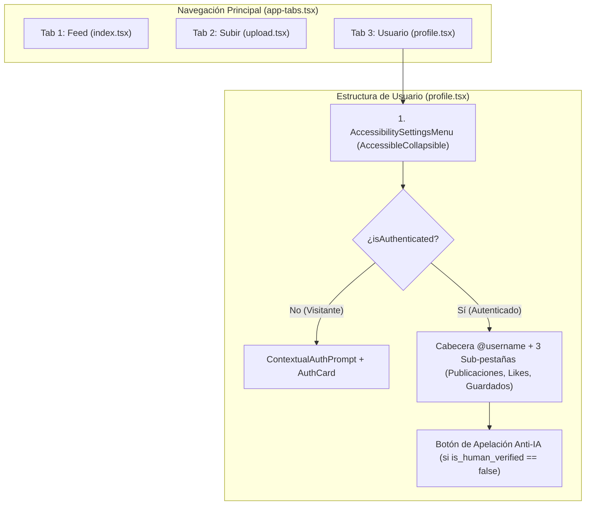

# Documentación Técnica Profunda — Fase 04: Navegación de 3 Pestañas, Compromiso Gradual (*Gradual Engagement*) y Pantalla de Usuario

> **Ubicación en el SDD:** [`docs/specs/04-navigation-and-profile.md`](../specs/04-navigation-and-profile.md)  
> **Alineación con las 3 Reglas del Proyecto (`docs/projectProposalDocs/`):**
> * [`Course Project Phase 3`](../projectProposalDocs/Course%20Project%20Phase%203%20-%20Entrega%20Final%20(Proyecto%20Final%20Desarrollo%20Móvil).md): Sección 3 (Navegación fluida sin bloqueos del hilo principal, separación de lógica/UI en Custom Hooks y datos reales de Supabase).
> * [`Project Proposal.pdf`](../projectProposalDocs/Project%20Proposal.pdf): Sección I.C (Atribución de creador y colecciones) y Sección IV.A (Mecanismo de apelación humana para falsos positivos del filtro Anti-IA).
> * [`2ndPhaseProposal.pdf`](../projectProposalDocs/2ndPhaseProposal.pdf): Sección V.A (Áreas táctiles $\ge 48\text{ dp}$, navegación por teclado con anillo de foco), Sección V.B (Diseño predecible con 3 pestañas fijas y lenguaje claro) y Sección V.D (Menú desplegable de accesibilidad con Alto Contraste AAA, Fuentes para Dislexia y Escalado al 200%).

---

## 1. Visión General: ¿Qué hace la Fase 04 en el conjunto del proyecto?

La **Fase 04** reemplaza la estructura inicial de plantilla (`Home` y `Explore`) por la arquitectura definitiva de **3 pestañas inferiores predecibles (`Feed`, `Subir`, `Usuario`)** bajo el estándar de la industria de **Compromiso Gradual (*Gradual Engagement / Deferred Authentication*)**:

1. **Navegación Inferior Unificada Móvil + Web ([`app-tabs.tsx`](../../frontend/src/components/app-tabs.tsx)):**
   * En lugar de mantener dos barras distintas entre móvil y web, utiliza `Tabs`, `TabSlot`, `TabList` y `TabTrigger` de `expo-router/ui` en un único componente accesible.
   * Cada una de las 3 pestañas (`Feed`, `Subir`, `Usuario`) garantiza un área táctil mínima de $48\times 48\text{ dp}$, retroalimentación háptica al cambiar de pestaña, escalado tipográfico dinámico hasta 200%, soporte de Alto Contraste AAA y anillo de foco por teclado (`Tab`).
2. **Autenticación Diferida (*Gradual Engagement* — NN/g, Apple HIG y WCAG 2.2 SC 3.3.8):**
   * El usuario puede abrir la aplicación, explorar el `Feed` y ajustar todas sus preferencias de accesibilidad en `Usuario` sin chocar contra un muro de login inicial (*Hard Login Wall*).
   * Cuando desea realizar acciones ligadas a una cuenta personal (ver sus colecciones de *Publicaciones*, *Likes* y *Guardados* en `Usuario`, o subir una foto en `Subir`), el componente [`ContextualAuthPrompt`](../../frontend/src/components/auth/contextual-auth-prompt.tsx) explica el beneficio y muestra la tarjeta de inicio de sesión / registro ([`AuthCard`](../../frontend/src/components/auth/auth-card.tsx)).
3. **Pantalla de Usuario con Menú Desplegable de Accesibilidad y Apelación Anti-IA ([`profile.tsx`](../../frontend/src/app/profile.tsx)):**
   * En la parte superior incluye el **Menú Desplegable de Opciones de Accesibilidad ([`AccessibilitySettingsMenu`](../../frontend/src/components/profile/accessibility-settings-menu.tsx))** usando nuestro patrón `AccessibleCollapsible` (*WCAG 2.4.1 Bypass Blocks*).
   * Debajo muestra las estadísticas reales del usuario (`@username`, contadores de *Publicaciones*, *Likes* y *Guardados*) y sus 3 pestañas de colecciones hidratadas desde Supabase mediante el hook [`useUserProfile`](../../frontend/src/hooks/use-user-profile.ts), incluyendo el botón para **Apelar el filtro Anti-IA** en caso de que una publicación propia haya sido retenida (`is_human_verified = false`).



---

## 2. Explicación Detallada Archivo por Archivo (De lo General a lo Específico)

### 2.1. [`frontend/src/components/app-tabs.tsx`](../../frontend/src/components/app-tabs.tsx) y [`app-tabs.web.tsx`](../../frontend/src/components/app-tabs.web.tsx) — Barra Inferior de 3 Pestañas

* **Propósito General:** Proveer una barra de navegación inferior fija, predecible y 100% accesible tanto en iOS/Android como en Web.
* **Detalle de Implementación:**
  * **`AurasTabButton`:** Envuelve cada pestaña con `accessibilityRole="tab"`, `accessibilityState={{ selected: Boolean(isFocused) }}`, `role="tab"` y `aria-selected` en Web. Al tocarla dispara `triggerHapticFeedback('light')` y al recibir foco por teclado (`onFocus`) pinta el borde `theme.focusRing` de `2px`.
  * **3 Triggers Oficiales:**
    1. `name="index"` (`href="/"`): **Feed**
    2. `name="upload"` (`href="/upload"`): **Subir**
    3. `name="profile"` (`href="/profile"`): **Usuario**
  * **Manejo de Safe Area:** Calcula `paddingBottom: Math.max(insets.bottom, Spacing.two)` usando `useSafeAreaInsets()` para no solaparse con la barra de gestos inferior de Android o iOS.

---

### 2.2. [`frontend/src/components/profile/accessibility-settings-menu.tsx`](../../frontend/src/components/profile/accessibility-settings-menu.tsx) — Menú Desplegable de Opciones de Accesibilidad

* **Propósito General:** Encapsular los controles de accesibilidad dentro de un bloque desplegable (`AccessibleCollapsible`) reutilizable y compacto.
* **Cómo funciona internamente:**
  * Muestra en el subtítulo del botón cerrado un resumen en vivo del estado actual (`"Tema: Alto Contraste (AAA) • Escala: 150%"`).
  * Si un usuario entra a `Usuario` solo para ver sus *Guardados* y navega con `Tab` o *TalkBack*, puede pasar de largo este botón sin tener que recorrer los 14 botones de configuración (*WCAG 2.4.1 Bypass Blocks*).
  * Al abrirlo, permite cambiar en tiempo real:
    1. **Tema y Contraste:** *Sistema*, *Claro (AA)*, *Oscuro (AA)* y *Alto Contraste (AAA)*.
    2. **Escalado de Texto sin Recorte:** `100%`, `125%`, `150%`, `175%` y `200%`.
    3. **Tipografía Apta para Dislexia:** *Estándar*, *Sans-Serif Legible (Verdana/Arial)* y *Monoespaciada (Courier)*.
    4. **Prevención de Fotosensibilidad:** Interruptor `accessibilityRole="switch"` para *Reducir Animaciones* y botón de *Restablecer ajustes*.

---

### 2.3. [`frontend/src/components/auth/contextual-auth-prompt.tsx`](../../frontend/src/components/auth/contextual-auth-prompt.tsx) — Componente de Compromiso Gradual (*Gradual Engagement*)

* **Propósito General:** Mostrar una explicación contextual clara antes del formulario `AuthCard` únicamente cuando el usuario visitante intenta acceder a funciones que requieren cuenta personal.

---

### 2.4. [`frontend/src/hooks/use-user-profile.ts`](../../frontend/src/hooks/use-user-profile.ts) — Custom Hook de Colecciones y Apelación Anti-IA

* **Propósito General:** Separar toda la lógica de negocio y consultas a Supabase de la vista `profile.tsx` (patrón *Headless Custom Hook*).
* **Detalle de Funciones y Estados:**
  * **`refreshProfileData()`:** Consulta en paralelo las tablas `public.looks` y `public.saved_looks` en Supabase para el usuario autenticado (`profile.id`), cruzándolas con los respaldos locales (`getLocalLookOverrides()`).
  * **Selectores Memoizados (`useMemo`):**
    * `myUploadedLooks`: Filtra `looks` donde `user_id === currentUserId` (incluyendo tanto los verificados como los retenidos por el filtro Anti-IA para que el autor pueda verlos y apelarlos).
    * `myLikedLooks`: Filtra `looks` donde `liked_by` contiene `currentUserId`.
    * `mySavedLooks`: Filtra `looks` presentes en `public.saved_looks` para `currentUserId`.
  * **`requestHumanAppeal(lookId)`:** Cumple la mitigación de falsos positivos de `Project Proposal.pdf` (Sección IV.A). Actualiza `appeal_status = 'pending'` tanto en la columna `public.looks.appeal_status` de Supabase como en el respaldo local, emite vibración de éxito (`triggerHapticFeedback('success')`) y anuncia el cambio al lector de pantalla (`announceStatus`).

---

### 2.5. [`frontend/src/app/profile.tsx`](../../frontend/src/app/profile.tsx) y [`frontend/src/app/upload.tsx`](../../frontend/src/app/upload.tsx) — Pantallas de Usuario y Subida

* En `profile.tsx`, renderiza la tarjeta de perfil (`@username`, contadores numéricos agrupados semánticamente para lectores de pantalla), las 3 sub-pestañas (*Publicaciones*, *Likes*, *Guardados*) y las tarjetas `ProfileLookItemCard` con insignias de verificación Anti-IA, muestras de color en español (`ColorSwatchBadge`) y el botón de apelación.
* Se eliminó el archivo de plantilla `explore.tsx` para mantener el repositorio limpio y compacto.

---

## 3. 🧪 Cómo Probar la Implementación de la Fase 04 Paso a Paso

### Paso 1: Verificar Compilación TypeScript (`0 errores`)
En la terminal dentro de `frontend/`:
```bash
cd frontend
npx tsc --noEmit
```

### Paso 2: Probar las 3 Pestañas, el Compromiso Gradual y el Perfil en Vivo (`npx expo start`)
1. Ejecuta en la terminal:
   ```bash
   cd frontend
   npx expo start
   ```
   *(Presiona `w` para abrir en Web o escanea el QR con Expo Go en tu celular).*
2. **Prueba 1 — Navegación Predecible sin Muro de Login (*Gradual Engagement*):**
   * Al abrir la app, verifica que entras directamente a la pestaña **`Feed`** sin ningún bloqueo de login y que en la parte inferior están fijas las 3 pestañas: **`Feed`**, **`Subir`** y **`Usuario`**.
   * Toca **`Subir`**: verás la **Guía de Iluminación desplegable** (ábrela y ciérrala) y el mensaje contextual invitándote a iniciar sesión cuando quieras subir una foto.
3. **Prueba 2 — Menú Desplegable de Accesibilidad en `Usuario` (incluso sin iniciar sesión):**
   * Toca la tercera pestaña **`Usuario`**.
   * En la parte superior verás el desplegable **"Opciones de Accesibilidad"**. Prueba cambiar a **Alto Contraste (AAA)**, **200% de escala** y **Fuente para Dislexia**, y luego contrae el menú tocando su encabezado: verás cómo las 3 pestañas inferiores también cambian su tamaño de letra y colores de alto contraste en tiempo real.
4. **Prueba 3 — Iniciar Sesión y Ver Colecciones Reales (`Publicaciones`, `Likes`, `Guardados`):**
   * En la misma pestaña **`Usuario`**, toca **"Probar rápido con perfil @aurasmatch_bot"** (o inicia sesión con tu cuenta de Supabase si ya pegaste `EXPO_PUBLIC_SUPABASE_ANON_KEY`).
   * **Resultado esperado:**
     * El formulario de login desaparece y aparece tu tarjeta de perfil **`@aurasmatch_bot`** con el contador real de **Publicaciones** (34 looks en Supabase cuando hay llave configurada, o las 3 publicaciones espejo reales).
     * Alterna entre las sub-pestañas **`Publicaciones`**, **`Likes`** y **`Guardados`**.
     * En **`Publicaciones`**, verifica que cada look muestra su foto, subcultura (`Goth`, `Clean Girl`, `Jirai Kei`), insignia `✅ 100% Humano` (o `⚠️ Retenido Anti-IA` con el botón **"Apelar filtro Anti-IA"**) y sus tonos extraídos con nombre en español (`ColorSwatchBadge`).

