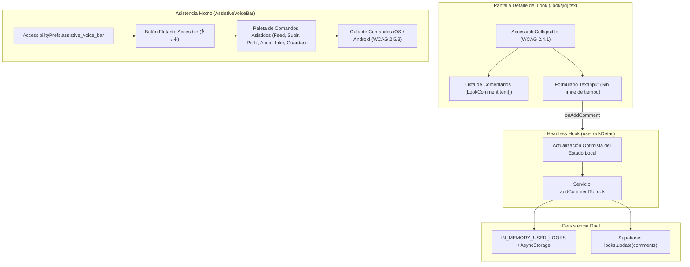

# Documento de Fase 08 — Extras de Baja Prioridad (Comentarios Desplegables y Barra Asistida de Comandos de Voz)

## 1. Visión General y Propósito de la Fase
La **Fase 08** culmina las promesas de baja prioridad formuladas en la propuesta de accesibilidad del segundo corte (`2ndPhaseProposal.pdf`), integrando dos capacidades clave para el uso inclusivo y la defensa técnica oral del proyecto:

1. **Sección de Comentarios de la Comunidad en el Detalle del Look (`2ndPhaseProposal.pdf` Sección V.D.2):**
   * Emplea el modelo de datos de la columna `looks.comments jsonb DEFAULT '[]'` agregada en la Fase 03.
   * Aplica el patrón unificado de desplegables accesibles [`AccessibleCollapsible`](../../frontend/src/components/ui/collapsible.tsx) (**WCAG 2.4.1 Bypass Blocks**), previniendo que los usuarios de lectores de pantalla (*TalkBack* y *VoiceOver*) o navegación por teclado deban recorrer decenas de comentarios antes de llegar a las recomendaciones de publicaciones afines.
   * Implementa un formulario de comentarios sin límite de tiempo (**WCAG 2.2.1 Timing Adjustable**), con contador de caracteres, validación visual mediante [`VisualAlertBanner`](../../frontend/src/components/ui/visual-alert-banner.tsx) y actualización optimista híbrida (Supabase + almacenamiento en memoria).

2. **Control por Voz y Asistencia Motriz (`2ndPhaseProposal.pdf` Sección V.A.3 & WCAG 2.5.3 Label in Name):**
   * Verifica la concordancia 1:1 entre los textos visuales de los botones y los atributos programáticos `accessibilityLabel` requeridos por los motores de voz del sistema operativo (*Voice Control* en iOS y *Voice Access* en Android).
   * Añade la opción **"Barra Asistida de Voz"** en el Menú de Accesibilidad del Perfil (`AccessibilityPrefs.assistive_voice_bar`).
   * Despliega la paleta flotante interactiva [`AssistiveVoiceBar`](../../frontend/src/components/ui/assistive-voice-bar.tsx) para ejecutar y simular comandos orales durante la demostración académica en vivo sin depender del micrófono del emulador o del navegador web.

---

## 2. Arquitectura de Componentes y Flujo de Datos



---

## 3. Detalle de Archivos Implementados y Modificados

### 3.1. [`frontend/src/components/look/comments-section-collapsible.tsx`](../../frontend/src/components/look/comments-section-collapsible.tsx)
* **Propósito:** Componente de comentarios plegable y accesible.
* **Características Clave:**
  * **Título y Subtítulo Dinámicos:** Muestra *"Comentarios de la Comunidad"* y *"X comentarios"* (o *"Sin comentarios aún — Sé el primero en opinar"*).
  * **Plegado por Defecto:** Al estar cerrado, el lector de pantalla lee el resumen en un único elemento interactivo y continúa hacia las publicaciones similares sin forzar el recorrido de la lista.
  * **Formulario sin Límite:** Campo multilínea con `maxLength={300}`, contador de caracteres restantes en tiempo real y botón de acción táctil $\ge 48\text{ dp}$ (*"Publicar"*).
  * **Validación Accesible:** Muestra [`VisualAlertBanner`](../../frontend/src/components/ui/visual-alert-banner.tsx) de tipo error en caso de campo vacío o exceso de caracteres, y banner verde de confirmación al publicar.
  * **Gradual Engagement:** Si el usuario no ha iniciado sesión, invoca `onRequireAuth()` para abrir el modal contextual de autenticación.

### 3.2. [`frontend/src/components/ui/assistive-voice-bar.tsx`](../../frontend/src/components/ui/assistive-voice-bar.tsx)
* **Propósito:** Botón flotante y paleta asistida para personas con diversidad motriz y apoyo a la sustentación oral ante el profesor.
* **Características Clave:**
  * **Botón Flotante (Pill):** Botón circular ($\ge 52\text{ dp}$) ubicado en la esquina inferior con icono $\text{🎙️}$ y badge $\text{♿}$.
  * **Paleta Expandible:**
    * **"Ir al Feed":** Navega a la vista principal.
    * **"Subir Look":** Navega a la cámara/subida.
    * **"Mi Perfil":** Navega a la pestaña de usuario.
    * **"Escuchar Pantalla":** Lee por síntesis de voz (`expo-speech` o Web TTS) el contexto de la vista actual.
    * **"Dar me gusta" y "Guardar look":** Simulan la ejecución de los comandos orales equivalentes con vibración háptica y anuncio de estado.
  * **Guía Desplegable de Integración Nativa (WCAG 2.5.3):** Explica cómo activar *Control por Voz* en iOS y *Voice Access* en Android, indicando las frases exactas reconocidas gracias a los `accessibilityLabel` del proyecto.

### 3.3. [`frontend/src/services/supabase.ts`](../../frontend/src/services/supabase.ts)
* **Función `addCommentToLook(lookId, comment)`:**
  * Agrega el nuevo objeto `LookCommentItem` a la memoria activa (`IN_MEMORY_USER_LOOKS`) y sincroniza el arreglo en `REAL_SUPABASE_MIRROR_LOOKS`.
  * Persiste en `AsyncStorage` cuando está disponible en modo local y notifica al resto de vistas vía `notifyLookDataChanged`.
  * Si Supabase está conectado y el ID es un UUID válido de Postgres, invoca el RPC `add_look_comment` (definido en [`docs/supabase-rls-and-rpcs.sql`](../supabase-rls-and-rpcs.sql)) con respaldo a `supabase.from('looks').update({ comments }).select('id, comments')`, lanzando un error explícito si RLS bloquea la escritura.

### 3.4. [`frontend/src/hooks/use-look-detail.ts`](../../frontend/src/hooks/use-look-detail.ts)
* **Ampliación del Hook:**
  * Expone `comments: LookCommentItem[]`, `addComment(content: string)` y `isAddingComment: boolean`.
  * Genera IDs conformes a RFC4122 (UUID) para cada comentario.
  * Realiza actualización optimista instantánea en el estado `look.comments`.
  * Emite vibración háptica (`triggerHapticFeedback('medium')`) y anuncio sonoro/hablado (`announceStatus`).

### 3.5. [`frontend/src/components/profile/accessibility-settings-menu.tsx`](../../frontend/src/components/profile/accessibility-settings-menu.tsx)
* **Bloque 5:** Agrega la sección *"5. Control por Voz y Asistencia Motriz (Diversidad Física)"* con el interruptor para activar o desactivar la paleta flotante.

### 3.6. [`frontend/src/app/_layout.tsx`](../../frontend/src/app/_layout.tsx)
* Integra `<AssistiveVoiceBar />` a nivel de raíz, permitiendo que la barra asistida esté disponible de forma persistente y no intrusiva en cualquier pantalla de la aplicación.

---

## 4. Guía Práctica de Pruebas y Verificación

### 4.1. Verificación de Compilación
Ejecuta en la terminal para confirmar que no existen errores de TypeScript:
```bash
cd frontend
npx tsc --noEmit
```
*Resultado esperado:* El comando termina con código 0 y sin errores.

### 4.2. Prueba Paso a Paso de Comentarios en el Detalle del Look
1. Inicia la app (`npx expo start --web` o en emulador móvil).
2. En el **Feed Comunitario**, presiona cualquier publicación para abrir la pantalla de detalle (`/look/[id]`).
3. Desplázate hacia abajo, superando la imagen, los botones de acción, la tarjeta Anti-IA y los Cosméticos por Región.
4. Ubica el bloque **"Comentarios de la Comunidad"**:
   * Verifica que se encuentre **cerrado por defecto** y que su subtítulo indique el número de comentarios (o *"Sin comentarios aún"*).
5. Toca el botón para **expandir el bloque**:
   * Observa la lista de comentarios formateados con inicial de usuario, `@username`, fecha relativa y contenido.
6. En la caja de texto *"Deja tu comentario sobre este look"*:
   * Escribe un texto y verifica que el contador de caracteres restantes se descuente de $300$ hacia abajo.
   * Si dejas el campo en blanco y presionas *"Publicar"*, verifica que aparezca un `VisualAlertBanner` de error solicitando escribir un mensaje.
7. Escribe un comentario válido y presiona **"Publicar"**:
   * Observa la vibración háptica, el anuncio sonoro de confirmación y la inclusión inmediata del comentario en la lista superior sin recargar la pantalla.
8. Presiona la flecha atrás para volver al feed y vuelve a entrar a la misma publicación:
   * Verifica que el comentario persiste correctamente en el detalle.

### 4.3. Prueba Paso a Paso de la Barra Asistida de Comandos de Voz
1. Dirígete a la pestaña **Usuario / Perfil**.
2. Despliega el menú **"Opciones de Accesibilidad"**.
3. Baja hasta la sección **"5. Control por Voz y Asistencia Motriz"**.
4. Presiona el botón para cambiar el estado a **"🎙️ Barra Asistida de Voz: ACTIVADA"**.
5. Observa cómo aparece inmediatamente en la esquina inferior derecha el **botón circular flotante (🎙️ / ♿)**.
6. Presiona el botón flotante:
   * Se abre la paleta expandible con sombra y borde accesible.
7. Presiona **"Escuchar Pantalla"**:
   * El sintetizador de voz lee en voz alta el contexto de la pantalla activa.
8. Presiona **"Ir al Feed"**:
   * La app navega de inmediato a la pestaña del Feed y emite vibración háptica.
9. En la paleta flotante, presiona **"▼ Ver frases nativas para iOS y Android"**:
   * Se expande la guía didáctica explicando el principio WCAG 2.5.3 (*Label in Name*) y las frases para *Voice Control* y *Voice Access*.
10. Presiona el botón **"✕"** en la esquina superior de la paleta:
    * La paleta se minimiza de nuevo al botón circular flotante sin estorbar el contenido.

